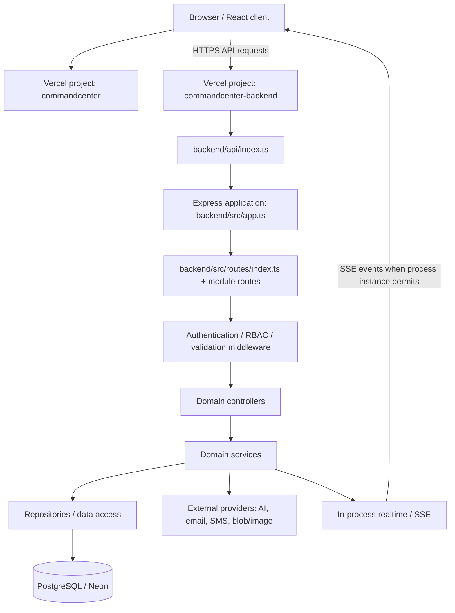

# CommandCenter — Comprehensive Technical Export of This Chat

**Export date:** 2026-10-19  
**Project:** CommandCenter  
**Primary repository:** `https://github.com/Rushi9234/CommandCenter`  
**Local workspace reported in this chat:** `D:\CommandCenter - Copy (2)`  
**Deployment target:** Vercel (frontend project `commandcenter`; backend project `commandcenter-backend`)  
**Runtime branch:** `vercel-runtime`  
**Important scope note:** This document captures the technical project context available in this conversation, with emphasis on the Git/GitHub/Vercel work and architectural notes supplied in the conversation history. It does **not** pretend to reproduce complete source files, SQL schemas, or source code that were never pasted into this chat. Where exact code/schema was not present, the limitation is recorded explicitly rather than invented.

---

## 0. Executive state / handoff summary

### 0.1 What happened in this chat

1. The local application had extensive implementation work in React/TypeScript and Express/TypeScript.
2. A broad Git staging set initially contained application code, audit/review documents, tests, migrations, environment templates, and QA/provisioning artifacts.
3. The user clarified a strict repository objective: GitHub should contain **only what is needed to build and run the production application on Vercel**, not review notes, markdown reports, roadmaps, current-state notes, tests, QA scripts, or local-only files.
4. Local commit `a69ca95` was created with message `chore: prepare minimal Vercel runtime repository`. It changed 167 staged paths (that is a commit/change count, not necessarily the complete checked-out tree count).
5. A normal push to `master` was rejected because GitHub `origin/master` had advanced to `5ce10b1`. No pull/reset/force-push was performed.
6. To protect the pre-existing GitHub `master`, commit `a69ca95` was pushed to a new branch, `vercel-runtime`.
7. An inspection of the GitHub branch then revealed that the first commit did not remove every file inherited from its parent tree. The Git index was cleaned with explicit `git rm --cached` operations. This retained those files on the local disk while staging their deletion from the Git tree.
8. Cleanup commit `274c288` was created with message `chore: remove non-runtime files from Vercel branch` and pushed to `vercel-runtime`.
9. GitHub tree browsing then showed only the root directories `backend/` and `frontend/` on `vercel-runtime`.
10. Vercel deployment screens showed Ready deployments for commit `274c288` under `vercel-runtime` in both `commandcenter-backend` and `commandcenter`. A promotion dialog was opened for the frontend and the user reported that the deployment showed Ready. The final active production alias was not conclusively confirmed from a final screenshot.
11. After that deployment, a frontend production-configuration gap was discovered: `frontend/postcss.config.js`, `frontend/tailwind.config.js`, and `frontend/vercel.json` had been removed from the Git tree as “non-runtime” files even though they are required for production styling/routing. Antigravity reported restoring and staging those three files, with a successful frontend build and whitespace check. That fix had **not** been committed, pushed, or redeployed by the end of the conversation.

### 0.2 Git state at the transition point

| Item | State established in the conversation |
|---|---|
| Local workspace | `D:\CommandCenter - Copy (2)` |
| Local branch name | `master` |
| Local `HEAD` | `274c288` (`chore: remove non-runtime files from Vercel branch`) before the last staged config-only fix |
| Remote GitHub `master` | `5ce10b1` after `git fetch origin`; it was not force-pushed or rewritten |
| Remote GitHub `vercel-runtime` | Verified with `git ls-remote` as `274c288b51bb1a35a9e7d09cffad572d884416d0` |
| Latest Vercel commit seen | `274c288` |
| Pending staged fix at the end | `A frontend/postcss.config.js`, `A frontend/tailwind.config.js`, `A frontend/vercel.json` according to Antigravity's report |
| Latest fix commit/push/deploy | None reported |
| Local files removed from Git tracking | Still present locally as untracked (`??`) files after using `git rm --cached` |
| Vercel end-to-end app behavior | Not verified by a completed login + API-backed workflow in the material available here |

**Immediate next step:** verify that the three frontend deployment-config files are staged and that no unrelated local files are staged; then get a fresh commit authorization before committing those exact three files, push `HEAD` to `vercel-runtime` only, and verify/redeploy both Vercel projects. Do not use `git add -A`, `git add .`, force-push, pull, reset, or clean in this workspace without deliberate review.

---

# 1. Executive project overview

## 1.1 Product intent

CommandCenter is a team/classroom work-coordination application that connects goals, tasks, evidence, work progress, notifications, team chat, work activity, and attention signals. It aims to give different roles useful views of shared work without exposing data from other teams or personal/shared scopes.

Major product capability areas reflected in the available project context:

- Authentication and account/profile workflows, including email-change and phone-verification phases.
- Team membership, team roles, invitations/join requests, and classroom/coordinator hierarchy.
- Projects and task collaboration/discovery.
- Goals and goal governance/review workflows.
- Goal → Task → Evidence linkage, including retained historical evidence/timeline behavior.
- Daily work/submissions and work-state history.
- Work transparency/activity logs and leader/team views.
- Work/Pulse feed and attention signals.
- Notifications and deep-link destinations.
- Direct/team chat with historical membership privacy.
- AI assistant endpoint based on explicitly user-supplied context, with context treated as untrusted.
- Avatar/profile image handling and cropping.
- Email and SMS provider abstractions.
- Analytics hierarchy for high-level overview, classes, teams, and members.

## 1.2 Architecture choice

**Architecture: modular monolith**, not microservices.

- The backend is one TypeScript/Express application organized into domain modules.
- Controllers, services, repositories, routes, middleware, configuration, and shared utilities are separated by responsibility.
- The same backend source tree supports ordinary server execution/building and a Vercel serverless API entrypoint.
- PostgreSQL is the relational persistence layer; Neon/PostgreSQL was the DB hosting context discussed.
- The frontend is a separate React/TypeScript/Vite app.
- Frontend and backend are deployed as distinct Vercel projects in the screens shared (`commandcenter` and `commandcenter-backend`).
- In-process realtime/SSE is the current known implementation, not a distributed broker-backed architecture.

The design favors explicit module boundaries and a single deployable backend rather than independently deployed microservices.

## 1.3 Technology stack supported by the conversation

### Frontend

- React + TypeScript.
- Vite for bundling and dev/build tooling.
- Tailwind CSS, via Tailwind configuration and PostCSS plugins.
- `frontend/index.html` as Vite's HTML entry.
- `frontend/vite.config.ts` as Vite config.
- TypeScript configuration files `frontend/tsconfig.json` and `frontend/tsconfig.node.json`.
- Frontend unit/component tests use Vitest and React Testing Library (based on earlier test reports and test files).
- Styling source includes `frontend/src/styles/index.css`.
- Frontend service/hooks/components/pages live under `frontend/src/`.

### Backend

Evidence in `backend/package.json` retrieved during the work includes these dependencies/scripts:

- Node.js + TypeScript.
- Express (`express` 4.x in the report’s package manifest).
- PostgreSQL client (`pg`).
- Authentication: `jsonwebtoken`, `bcrypt`.
- Request validation: `zod`.
- Middleware/security: `helmet`, `cors`, `cookie-parser`, `express-rate-limit`.
- Email: `nodemailer`, `resend` and an email provider factory.
- SMS abstraction and provider implementations, including console and MSG91 providers.
- AI provider abstraction with Groq and Gemini providers.
- Avatar/image support: `sharp`, `@vercel/blob`.
- `dotenv` is in dependencies, but production Vercel values should be injected via Vercel environment variables rather than relying on committed `.env` files.
- Build: `npm run build` → `tsc`.
- Local dev: `ts-node-dev --respawn --transpile-only src/server.ts`.
- Non-Vercel start script in package metadata: `node dist/server.js`.
- DB migrations package/script exists in the local package metadata: `node-pg-migrate`, `migrate:up`, `migrate:down`, `migrate:create`. However, the migration files were intentionally removed from the minimal runtime branch; migration application is therefore an out-of-band release/deployment responsibility unless the deployment architecture is changed.

### Deployment

- Vercel frontend project: `commandcenter`.
- Vercel backend project: `commandcenter-backend`.
- Backend Vercel entrypoint: `backend/api/index.ts`.
- Backend Vercel configuration: `backend/vercel.json`.
- Frontend Vercel SPA rewrite config is `frontend/vercel.json` and was found necessary enough to restore after it was removed.
- Frontend styling configs are `frontend/postcss.config.js` and `frontend/tailwind.config.js`; those were also restored/staged at the end of the chat.

## 1.4 Database platform: PostgreSQL, not MySQL or MongoDB

The project data in this conversation is PostgreSQL-oriented. `pg`, PostgreSQL/Neon connection URLs, SQL migrations, `node-pg-migrate`, and relational tables were all discussed. There is **no basis in this chat to document a MySQL or MongoDB configuration**. This export therefore does not invent one.

---

# 2. Architectural blueprint and system design

## 2.1 Deployment shape



This is a logical diagram from the known implementation shape, not a deployment manifest copied verbatim from source code. The actual Vercel settings (root directory, build/output fields, environment values, alias state) must be checked in the Vercel dashboard.

## 2.2 Backend module layering

Typical module layout follows the structure below (illustrative tree; exact files vary by module):

```text
backend/src/
  app.ts
  server.ts
  routes/
    index.ts
  common/
    dto-helpers.ts
    phone.ts
    middleware/
      errorHandler.ts
      requireConversationParticipant.ts
      requireTeamRole.ts
      validate.ts
    rateLimit/
      expressRateLimitProvider.ts
      rateLimitProvider.interface.ts
  config/
    env.ts
  controllers/
  middleware/
    auth.ts
  db/
    client.ts
  modules/
    ai/
    analytics/
    attention/
    auth/
    avatars/
    blockers/
    chat/
    dailyWork/
    goals/
    guidance/
    leaderboard/
    logs/
    notifications/
    projects/
    pulse/
    teams/
    users/
    workStateHistory/
    worklog/
  realtime/
  services/
    email/
    sms/
  utils/
```

### Controller/service/repository responsibility map

| Layer | Responsibilities |
|---|---|
| Routes | Map HTTP method/path to middleware and controller handlers; central route registration in `backend/src/routes/index.ts`. |
| Middleware | Authentication, team-role enforcement, conversation participation authorization, validation, rate limiting, common error response handling. |
| Controllers | Translate HTTP request/validated DTO into service calls; translate results/errors to HTTP responses. |
| DTO/validation | Define and validate incoming request shapes (Zod-backed validation is in the stack). |
| Services | Domain rules, workflow state transitions, membership checks, orchestration, event/notification side effects. |
| Repositories | SQL/database reads and writes; repositories are present in domains where query complexity/access policy benefits from isolation. |
| DB client | `backend/src/db/client.ts`, PostgreSQL connection-pool initialization. |
| Provider factories | Select AI/email/SMS provider implementations based on runtime configuration. |
| Realtime provider | In-process implementation; event delivery is not durable/distributed by the information available here. |

## 2.3 Authentication and authorization principles

- Backend authorization is authoritative. Frontend controls/hiding are only UX affordances and must not be relied upon for security.
- Requests should validate authenticated identity and membership/role server-side before reading/mutating team-scoped data.
- `requireTeamRole` is part of team-role enforcement.
- `requireConversationParticipant` protects chat conversation endpoints so only a conversation participant can access that conversation's messages/actions.
- Zod/validation middleware validates request payloads; malformed JSON was corrected to produce HTTP 400 rather than 500.
- Error handling is centralized in `backend/src/common/middleware/errorHandler.ts`.
- Rate limiting is abstracted through an interface and an Express-backed provider (`rateLimitProvider.interface.ts`, `expressRateLimitProvider.ts`).

## 2.4 Frontend navigation and route layout

The known user-facing routes/route groups are:

- `/work` and `/pulse`: unified work/pulse experience; user-facing label includes “Work Activity”.
- `/teams`: teams landing/list.
- `/teams/:teamId`: standard team page.
- `/classrooms/:teamId`: classroom/container route.
- `/analytics`: overview/analytics landing.
- `/analytics/classes/:classId`: class analytics.
- `/analytics/classes/:classId/teams/:teamId`: team analytics within a class.
- `/analytics/classes/:classId/teams/:teamId/members/:memberId`: member analytics within a class/team.
- Equivalent unparented-team analytics routes exist for teams not under a class hierarchy (exact path patterns beyond the routes above are not reproduced because the available context does not give all of them).

Analytics hierarchy agreed in the design context:

```text
Analytics
├── My Overview
├── My Progress
├── My Classes
│   └── Class
│       └── Team
│           └── Member
└── My Teams
    └── Team
        └── Member
```

Responsibilities are separated: class views can roll up teams and members; operational team pages are not intended to become a substitute for the entire analytics domain; Overview remains high-level.

## 2.5 Goal → Task → Evidence model

The known design establishes these relationships/semantics:

- Tasks may reference a goal via `goal_id` (a task-to-goal foreign key was added in a migration that exists locally but is not currently in the minimal Vercel branch tree).
- Task and goal association must be validated as belonging to the same team.
- Goal progress is a hybrid calculation/override workflow; exact formulas/column list are not available in this chat and should not be fabricated.
- `done` is interpreted as verified completion.
- `review` / `submitted` are in-flight workflow states rather than fully completed verified work.
- `changes_requested` transitions back to `in_progress`.
- Timeline/history preserves deleted-task evidence instead of losing the historical trace.
- `GoalDetailView` displays linked tasks, evidence, and timeline.
- Goal creation/review governance exists and is guarded by service/controller rules.

## 2.6 Chat V1 architecture

Chat scope and product constraints captured in the project context:

- Direct 1:1 chat and canonical team chat.
- Flat conversation model for V1.
- No attachments in V1.
- Do not claim end-to-end encryption (E2EE); this was explicitly not a supported claim.
- Moderation tools were excluded from V1 scope.
- Message retention is indefinite in V1; no automatic expiry is asserted.
- Team deletion cascades to team chat data according to the designed lifecycle.
- DMs are limited to users who share the current team (authorization rule from the implementation context).
- Messages are immutable in the V1 design.
- Tables: `conversations`, `conversation_participants`, `chat_messages`.
- A team participant read cursor is cached for read/unread handling.
- Realtime is in-process SSE; no durable distributed pub/sub broker is evidenced.
- Historical conversation/message access is membership-sensitive: a user must not see messages from before joining a team if the design's membership timeline rule disallows them.
- Server-side participant middleware is `requireConversationParticipant`.

## 2.7 Work transparency, Pulse and attention

Known work-transparency components include:

- Worklog API: `GET /api/teams/:id/worklog?limit=50`.
- Worklog query orchestration was bounded to six parallel queries and a maximum row limit of 100 per configured query path (the API's default query limit is 50 in the example above).
- Work-state history retains transitions for timeline/audit purposes.
- Pulse/attention aggregates explainable signals rather than a black-box score.
- Attention categories known from the implementation context:
  1. `UNRESOLVED_BLOCKER`
  2. `STALLED_TASK`
  3. `OVERDUE_TASK`
  4. `REOPENED_WORK_FLAPPING`
  5. `GOAL_PROGRESS_STALLED`
  6. `MISSING_DAILY_SUBMISSION`
  7. `PENDING_JOIN_REQUEST`
  8. `SUBTEAM_AT_RISK`
- Related components/services include `WorkPulseFeed`, `WorkActivityTimeline`, `TeamLeaderWorklogDashboard`, `AttentionActionCenter`, pulse service/repository/controller/routes, and workStateHistory module.
- User-facing navigation unifies Work/Pulse around “Work Activity”.

## 2.8 Projects and collaborators

The collaborator/discovery rules established in previous project work:

- Public unparented/personal projects can be discoverable; private projects are excluded from discovery.
- Accepted collaborators can perform permitted task writes.
- Project creators/owners retain owner capabilities, including approval/rejection and deletion where allowed.
- Accepted collaborators do not automatically receive all owner-only delete permissions.
- Frontend assignment candidates for an independent project include its owner and accepted collaborators.
- Backend access checks were expanded to recognize project creator, eligible non-viewer team member, accepted collaborator, and task owner/creator according to the operation.
- Collaborator approval/rejection may trigger notifications and deep links.

## 2.9 Classroom/team ownership regression

A class ownership bug was traced to a discriminator mismatch:

- Service queried `team_type='classroom'`.
- Persisted DB values used `team_type='class'`.
- The query was fixed to support `class`/`classroom` where needed.
- Classroom containers were excluded from ordinary “my teams” listing.
- Class IDs were prevented from being treated as standard team analytics IDs.
- The fix did not require a DB write/schema mutation.

## 2.10 AI governance and data boundaries

Known AI contract:

- Endpoint: `POST /api/ai/chat`.
- Request body fields: `message`, optional `context`, optional `teamId`.
- When `teamId` is provided, the service checks active membership.
- The `context` is user-supplied/client-supplied context, **not** authoritative server-side DB retrieval.
- No RAG/vector search is implemented/evidenced in this V1 scope.
- Prompts treat supplied context and messages as untrusted input.
- PII masking exists in the described flow.
- Classroom scope is not supported in the AI context path described here.
- Provider abstraction includes Groq and Gemini; configuration/factory chooses provider.

## 2.11 Realtime boundary

- In-process SSE is the current implementation.
- It may work across requests landing on the same process, but should not be described as globally durable or cross-instance guaranteed without a shared broker/backplane.
- The minimal Vercel runtime deployment may run many serverless instances; therefore realtime semantics need operational verification in a real deployed multi-instance environment before claiming robust cross-user realtime behavior.

---

# 3. Core system components and codebase seeds

## 3.1 Repository layout in the final GitHub `vercel-runtime` branch

The GitHub tree was verified after commit `274c288` to have only these root entries:

```text
/
├── backend/
└── frontend/
```

The cleaned Git tree intentionally excluded root documentation and development files; it did **not** mean those files were wiped from the Windows working folder.

### Backend repository layout

```text
backend/
  api/
    index.ts
  package.json
  package-lock.json
  tsconfig.json
  vercel.json
  src/
    app.ts
    server.ts
    common/
    config/
    controllers/
    db/
      client.ts
    middleware/
    models/
    modules/
    realtime/
    routes/
    services/
    utils/
```

The folder names above summarize the project structure known from the chat. The exact leaf-file listing is not fully represented in this export.

### Frontend repository layout

```text
frontend/
  index.html
  package.json
  package-lock.json
  tsconfig.json
  tsconfig.node.json
  vite.config.ts
  src/
    App.tsx
    main.tsx
    vite-env.d.ts
    styles/
      index.css
    components/
    hooks/
    pages/
    services/
    utils/
    assets/
```

**Important late correction:** `frontend/postcss.config.js`, `frontend/tailwind.config.js`, and `frontend/vercel.json` were restored and staged after commit/push `274c288`, because their removal caused a production deployment-configuration concern. They were not yet part of a new commit/push/deployment at the end of the chat. They should be considered required configuration, not documentation-only files.

## 3.2 Backend package scripts

The backend package manifest inspected during the work contained these scripts (as reported from `backend/package.json`):

```json
{
  "scripts": {
    "dev": "ts-node-dev --respawn --transpile-only src/server.ts",
    "build": "tsc",
    "start": "node dist/server.js",
    "migrate:create": "node-pg-migrate create --migration-file-language sql --",
    "migrate:up": "node-pg-migrate up",
    "migrate:down": "node-pg-migrate down",
    "cleanup:refresh-tokens": "ts-node --transpile-only src/jobs/cleanupRefreshTokens.ts",
    "test": "jest --runInBand --forceExit",
    "test:watch": "jest --runInBand --watch"
  }
}
```

The actual Vercel serverless deployment uses `backend/api/index.ts` and `backend/vercel.json`; do not assume the normal `start` script describes how Vercel serves requests. Verify the Vercel project root-directory and build settings independently.

## 3.3 Backend Vercel entrypoint

Known files:

- `backend/api/index.ts`: Vercel serverless handler/entrypoint.
- `backend/vercel.json`: serverless routing/configuration.
- `backend/src/app.ts`: Express app construction and middleware/routes.
- `backend/src/server.ts`: normal Node server entry (used by `dev`/`start` scripts).

The full contents of these files were not pasted in this chat. Therefore this export does not invent the exact `module.exports`/handler wrapper, rewrite syntax, timeout setting, or route map in the JSON config.

## 3.4 Frontend production build configuration

The late configuration audit found the following files had been mistakenly excluded from the runtime branch and needed to be restored:

### `frontend/postcss.config.js`

Purpose reported by Antigravity: configure PostCSS plugins (`tailwindcss` and `autoprefixer`) so Vite processes Tailwind CSS classes for the production stylesheet.

The exact file content was not included in the report, so it is not reproduced verbatim here.

### `frontend/tailwind.config.js`

Purpose reported by Antigravity: Tailwind content paths include:

- `./index.html`
- `./src/**/*.{js,ts,jsx,tsx}`

It also configures the design system's primary palette, fonts, shadows, and keyframe animations. Exact token values and source are not available here.

### `frontend/vercel.json`

Purpose reported by Antigravity: SPA client-side rewrite:

```json
{
  "rewrites": [
    { "source": "/(.*)", "destination": "/index.html" }
  ]
}
```

This is the structure reported in the deployment-config fix. Confirm the actual staged file in the workspace before reusing it as a literal source artifact.

## 3.5 PostgreSQL schema and migrations

### Database platform

- PostgreSQL is the explicit relational DB technology.
- Neon/PostgreSQL was the hosted DB context.
- Backend connections use `pg` via `backend/src/db/client.ts`.
- Connection details should be supplied as environment values; real production credentials must not be stored in the repo.

### Schema information actually known

The chat context names the following tables as part of application/QA state:

- `users`
- `teams`
- `team_members`
- `projects`
- `project_collaborators`
- `tasks`
- `goals`
- `blockers`
- `daily_logs`
- `submissions`
- a history/work-state-history structure
- `conversations`
- `conversation_participants`
- `chat_messages`
- `notifications`
- `join_requests`
- `invites`

These names are not a substitute for the full actual SQL schema. Full table definitions, types, constraints, indexes, and migration contents were not included in this user turn; they cannot be reconstructed safely from table names alone.

### Migration strategy and critical deployment caution

- The backend package contains `node-pg-migrate` scripts (`migrate:up`, `migrate:down`, etc.).
- The minimal Vercel runtime branch deliberately excludes `backend/migrations/**` and `database/schema.sql` under the user's strict “runtime files only” rule.
- This means a fresh/empty database cannot be assumed to be initialized by the runtime branch.
- An existing DB must already have all required tables, columns, and indexes, or migrations/schema must be managed through a separate controlled release path outside this minimal branch.
- Before production rollout or use with a fresh DB, restore/manage schema and migrations securely in an operations/migration repository or other controlled deployment workflow. Do not run seed/reset scripts against production.

### Destructive QA seed warning

`backend/scripts/seedRichQAData.ts` / `backend/src/db/provisionRichQA.ts` / related QA provisioning scripts were identified as destructive or QA-only. A rich QA seed had previously truncated/recreated tables and removed original local QA data, including an `Akash` entry in that DB. Neon point-in-time recovery/branch/snapshot before approximately `2026-09-17 18:29 IST` was identified as the likely recovery route. **Do not rerun rich QA seeds or reset scripts.** This is a historical project context item; recovery should be handled carefully against the actual DB provider and snapshot state.

## 3.6 Environment-variable model

The repo had historically contained several templates/config files that were scrubbed and then intentionally excluded from the minimal branch:

- `.env.example`
- `backend/.env.example`
- `backend/.env.test.example`
- `backend/.env.docker`

During cleanup, staged values were checked for five keys:

- `DATABASE_URL`
- `REDIS_URL`
- `MONGODB_URL`
- `JWT_SECRET`
- `GROQ_API_KEY`

All five in the staged `backend/.env.docker` were ultimately reported as local placeholders/example values; `GROQ_API_KEY` had initially failed the scanner and was replaced with `your_groq_api_key_placeholder` and re-staged. Other templates were reported to contain placeholders/local examples.

No actual secret values are reproduced here. One real Neon DB credential had been pasted in prior script content and must be treated as compromised; rotate it before production/GitHub use. Do not put that value into this export.

### Production environment principles

- Vercel production secrets should be configured in Vercel Project Settings → Environment Variables.
- Do not expect `.env.example` or `.env.docker` to be read automatically by Vercel at runtime.
- Required/optional environment keys should be confirmed from `backend/src/config/env.ts` and the provider factories.
- Likely relevant settings discussed by name include `DATABASE_URL`, `JWT_SECRET`, AI provider key (e.g. `GROQ_API_KEY`), and provider credentials for email/SMS/blob storage. This list is indicative, not an authoritative complete `.env` contract.
- `REDIS_URL`/`MONGODB_URL` appeared in the scanner pattern; their actual use was not established as part of this chat and they should not be added to production unless the application explicitly requires them.

## 3.7 Core API contracts known from the chat

### AI assistant

```http
POST /api/ai/chat
Content-Type: application/json
```

Known body fields:

```json
{
  "message": "string",
  "context": "optional user-supplied context",
  "teamId": "optional team identifier"
}
```

Semantics and safeguards:

- `message` is the user's prompt.
- `context` is supplied by the client and must be treated as untrusted data, not as an authoritative server read of project records.
- Optional `teamId` triggers an active membership check.
- Prompt instructions treat the incoming context/message as untrusted and include PII masking in the described flow.
- No vector database, embedding store, or RAG-based authoritative retrieval was represented in this V1 scope.
- Classroom-scoped AI context was not supported in the known flow.

### Team worklog

```http
GET /api/teams/:id/worklog?limit=50
```

Known constraints:

- Default/example limit: 50.
- Service executes at most six bounded parallel queries in the described implementation.
- Individual query/collection limits are bounded (maximum 100 in the project context).
- Treat this as a bounded read model, not an unlimited audit dump.

### Analytics routes

```text
/analytics
/analytics/classes/:classId
/analytics/classes/:classId/teams/:teamId
/analytics/classes/:classId/teams/:teamId/members/:memberId
```

Additional equivalent analytics routes exist for teams outside a classroom hierarchy, but the exact paths were not recorded in the context available here.

### Team/work/chat routes

- `/work` / `/pulse`
- `/teams`
- `/teams/:teamId`
- `/classrooms/:teamId`

The full HTTP method + endpoint inventory was not supplied in this chat. Do not infer a complete route list from file names.

## 3.8 Table / dataset snapshot from historical QA work

A synthetic rich-QA topology was described before this Git/deployment work. It is included as test-context evidence, not production data:

- 14 synthetic users: Rush, Raju, Sham, Amit, Neha, Pooja, Kiran, Ravi, Sita, Mohan, Nikhil, Priya, Arun, Vikram.
- Test emails followed `name@commandcenter.local`.
- Three classes A/B/C.
- Twelve class teams A1–A4, B1–B4, C1–C4.
- Three unparented teams X/Y/Z.
- `team_members`: 61 rows.
- Pooja is in A1, B2, and X in the test topology.
- The data seed had Rush as owner of all class teams despite an earlier desired topology; note that as a test-data limitation, not intended production access policy.
- Earlier post-seed forensic counts: users 14, teams 18, team_members 61, projects 18, project_collaborators 4, tasks 49, goals 19, blockers 9, daily_logs 24, submissions 55, history 42, conversations 1, chat messages 5, notifications 6, join_requests 0, invites 0.
- Password hashes were audited as bcrypt cost 12 with no plaintext/hash exposure in read responses; avoid embedding QA passwords in repo or documentation.
- Chat historical privacy test scenario: Pooja joined A1 two days earlier and Rush ten days earlier; Rush could see pre-join messages while Pooja only saw permitted post-join content under that test rule.
- Project scope privacy scenario: Rush viewing Pooja in team A1 only sees A1 tasks, not Pooja's B2/X tasks or personal-project scope.
- Mutation isolation scenario: Raju changing task status in A1 updated A1 and not B2.
- Accepted collaborators could write permitted task data without gaining owner-only project/task deletion rights.

## 3.9 Exact file names / code areas changed in implementation history (where known)

The Git output from commit `a69ca95` reported newly introduced runtime code such as:

- Backend: `backend/api/index.ts`, conversation participant middleware, phone utility, Gemini provider, analytics and attention modules, avatar module, chat module, guidance module, notifications, pulse, user DTOs, work-state history, worklog, in-memory realtime provider, SMS providers/service.
- Frontend: assign-work/assigned-to-me components, attention action center, classroom coordinator dashboard, goal details, guidance banner, member detail view, notification bell, guidance/review modals, quick overview, sidebar/spotlight tour/team leader worklog dashboard, work activity and pulse feed, charts, chat components/page, common avatar/search/status/selector components, hooks for unread chat/realtime/overview/teams guide, overview/profile/verify-email-change pages, guidance/pulse/realtime/timeline services, avatar/crop/date/hierarchy utilities.

This is not intended as an exhaustive path list; Git itself is the source of truth for the exact tree at each commit.

---

# 4. Edge cases, regressions, troubleshooting and fixes

## 4.1 Git history divergence and safe push strategy

### Symptoms

Normal push was rejected:

```text
! [rejected] master -> master (fetch first)
error: failed to push some refs
remote contains work that you do not have locally
```

`git fetch origin` advanced `origin/master` from `f15ab3a` to `5ce10b1`. Local `HEAD` was `a69ca95` and had diverged from remote history. GitHub remote commits included security placeholder cleanups and earlier product changes.

### Resolution

- Did not run `git pull`, `git reset --hard`, or force-push.
- Created/pushed a separate branch by using the existing local commit:

```cmd
git push origin HEAD:vercel-runtime
```

Remote verified:

```text
a69ca95b653553ab1a1db77f6f34965294c14271 refs/heads/vercel-runtime
```

- This preserved the existing GitHub `master` branch.

## 4.2 Why the first “minimal runtime” commit still showed Markdown and setup files on GitHub

A crucial Git distinction was uncovered:

- A commit showing `167 files changed` does not imply its entire resulting tree contains only those 167 files.
- A commit based on a history that already tracks files inherits parent-tree paths unless those paths are explicitly deleted from the Git tree.
- Browsing `vercel-runtime` after `a69ca95` showed `.github/`, Markdown files, `docker-compose.yml`, `database/`, and setup scripts still present.

This led to an explicit tracked-file cleanup using `git rm --cached` rather than deleting the physical working-tree files.

## 4.3 Preserve local files while removing them from Git

The cleanup commit reported `delete mode 100644 ...` for 97 paths. Afterward, `git status --short` showed the files as untracked (`??`), and `dir README.md`, `dir DATABASE_SETUP.md`, and `dir backend\tests` proved those files still existed on disk.

This confirms the intended operation:

- Git index/tree: files removed from the runtime branch.
- Local disk: files preserved, now untracked.

Do not run `git clean` to “fix” the untracked state; that would risk deleting the preserved local artifacts.

## 4.4 Whitespace-check failures and cleanup process

`git diff --cached --check` initially failed across many newly staged Markdown/source files due to trailing whitespace and whitespace on blank/end-of-file lines. Early Python cleanup commands did not work reliably; one reported `CLEANED_AND_RESTAGED: 0` because its comparison logic was flawed. Further attempts were made with Antigravity instead.

Antigravity later reported:

- 295 staged files inspected in one intermediate stage.
- 24 files had whitespace/EOF cleanup.
- Content modifications: 0, according to the report.
- `git diff --cached --check`: PASS.
- Excluded QA files: none staged.

A later staging reset/allowlist process brought the change set to the minimal runtime approach. Do not treat the intermediate 295-file count as the final repository file count.

## 4.5 Staged environment template scanner caught a non-placeholder AI key

A targeted staged check initially printed:

```text
DATABASE_URL: PLACEHOLDER/LOCAL
REDIS_URL: PLACEHOLDER/LOCAL
MONGODB_URL: PLACEHOLDER/LOCAL
JWT_SECRET: PLACEHOLDER/LOCAL
GROQ_API_KEY: NON-PLACEHOLDER — FIX REQUIRED
```

The local file was changed to a placeholder (`GROQ_API_KEY=your_groq_api_key_placeholder`) and re-staged. The subsequent staged check reported all five values as placeholder/local. The final runtime branch later excluded `.env.docker` and `.env.example` files altogether.

## 4.6 Secret handling

- High-confidence secret scans and database-URL scans were reported as passing at the final staging gate.
- A real Neon DB credential had been pasted in previous scripts, so it was marked compromised in the project context and requires rotation.
- Do not ever reintroduce real connection URLs into docs, examples, or Git history.
- Environment values belong in Vercel Project Settings and local secret files that remain excluded/ignored from version control.
- If a credential has ever landed in a public commit, replacing the text in a later commit is not sufficient to revoke it; rotate the credential first.

## 4.7 Removal of build-critical files was a false “minimal runtime” classification

Antigravity removed these frontend files while enforcing a very strict non-runtime exclusion:

- `frontend/postcss.config.js`
- `frontend/tailwind.config.js`
- `frontend/vercel.json`

A subsequent report explicitly identified them as production deployment config, restored and staged them, and ran a successful frontend build. The SPA rewrite is required for client-side route refresh/deep-links; PostCSS/Tailwind config controls CSS generation/theme/content scanning.

**Critical handoff:** those three files were staged, not yet committed/pushed/deployed. The existing `274c288` remote tree therefore still lacks them. Do not call the frontend deployment fully correct until these files have been committed/pushed to `vercel-runtime` and the frontend is redeployed/verified.

This is a broader lesson: “only runtime files” does not mean “only `.ts/.tsx`”. Build configuration, CSS processing configuration, static HTML entrypoints, Vercel routing manifests, and the files those configs consume can be essential to production runtime.

## 4.8 Vercel status: Ready versus Production

Vercel deployment lists showed rows for `274c288` and `a69ca95` on `vercel-runtime` marked **Ready**, with a **Preview** badge visible in at least one screenshot. A production promotion dialog for `274c288` on frontend project `commandcenter` was opened and showed alias `commandcenter-sand.vercel.app`; the user reported the deployment later showed Ready.

Important distinction:

- “Ready” means the deployment finished successfully.
- “Ready” alone does not prove that the deployment is the active Production alias.
- A final screenshot confirming the 274c288 deployment’s Production badge/domain was not provided in the available record.
- The project was later found to need the three frontend config files, which were not yet redeployed at the end of the conversation.

Therefore the safest truth is: deployments for `274c288` were Ready, a promotion was initiated, but final production alias status and end-to-end behavior should be reverified after the three configuration files are committed and deployed.

## 4.9 Class/classroom discriminator mismatch

Regression:

- The service filtered for `team_type='classroom'`.
- Stored values use `team_type='class'`.

Fixes recorded:

- Query logic supports real persisted discriminator values.
- Classroom containers should not appear as ordinary operational teams.
- Class identifiers should not pass as normal team analytics identifiers.
- No DB data/schema mutation was required for the code fix.

## 4.10 Project collaborator authorization inconsistency

Observed/verified behavior after the fix:

- Backend project/task access can recognize the creator/owner, eligible team member, accepted collaborator, and task owner/creator where appropriate.
- Frontend independent project assignee list includes project owner + accepted collaborators.
- Accepted-collaborator badge/status exists.
- Delete is gated on frontend and backend, and an accepted collaborator doesn't automatically gain owner delete rights.
- Targeted collaboration tests were reported as passing.

## 4.11 Historical chat privacy

The design disallows arbitrary access based solely on knowing a conversation ID. Conversation participants and membership timeline are involved in authorization. The service should not disclose past messages that are outside the user's permitted timeline. Historical privacy was checked with users who joined a shared team at different times.

## 4.12 API malformed JSON status

Malformed JSON originally produced a server error response (500) in a hardened validation flow. It was corrected to return a client error (400). This is the expected semantic class for a malformed client payload.

## 4.13 Realtime scaling limitation

Because the known event provider is in-process SSE, successful local tests do not prove cross-instance event distribution in Vercel serverless. Future design must either accept that limitation explicitly or introduce a shared pub/sub/backplane and test multi-instance delivery. Do not claim guaranteed global realtime without proving it.

---

# 5. Verification and test evidence (with confidence boundaries)

## 5.1 Previously reported local checks

Before this final repository cleanup work, a verification snapshot reported:

- Frontend TypeScript: exit 0.
- Backend TypeScript: exit 0.
- Frontend Vitest: 451/451 tests passed.
- Targeted backend collaborator tests: 6/6 passed.
- `git diff --check`: 0 errors.
- Frontend production build: exit 0.
- Backend production build: exit 0.
- Frontend build emitted a Rollup chunk-size advisory (>500 kB); the build still exited successfully.

These are historical reports and should not be mistaken for test runs after the final Git tree cleanup. Removing test files from the production branch is a repository-content choice; test suites should remain in local workspace or a separate QA/development repository for maintainability.

## 5.2 Builds during final runtime/config work

Reported by Antigravity:

- Frontend command: `cd frontend && npm run build`.
  - Exit code: 0.
  - One report: Vite `5.4.21`, 509 modules transformed, `dist/index.html` 0.49 kB, CSS 71.48 kB, JS 757.88 kB; build duration reports varied from about 8.03s to 14.46s depending on run.
- Backend command: `cd backend && npm run build`.
  - Exit code: 0.
  - TypeScript compiled `backend/src/` to `backend/dist/`.
- Whitespace check after cleanup: `git diff --check` or `git diff --cached --check` reported exit 0 in the relevant stages.
- Frontend deployment-config fix (three files restored/staged): frontend production build exit 0; `git diff --cached --check` exit 0.

The reported outputs are from Antigravity's final reports pasted by the user; the source logs were not independently executed by ChatGPT in the container.

## 5.3 Real-world experience scenarios covered in prior work

The project-wide QA principles captured in context require testing real roles/workflows instead of only happy-path APIs:

- Member, team leader, teacher/coordinator personas.
- Multiple teams and classrooms; shared work versus personal work.
- Populated and empty entities.
- Unauthorized access attempts.
- Deep links, browser refresh, back/forward.
- Rapid team switching/races/stale data.
- Large data volumes.
- Normal zoom and responsive layouts.
- Browser console/network issues.
- Automated correctness plus realistic workflow correctness.

These are acceptance principles, not a claim that every scenario passed against the latest deployed production commit.

## 5.4 Capacity and production claims

A capacity benchmark/report existed in the broader project context, but the current export does not contain the raw benchmark output. Do not claim readiness for 200–500 teams or 100–200+ classrooms based solely on the current build pass. That scale goal requires measured load/performance, failure/recovery, observability, and tenant/team isolation evidence.

---

# 6. Git, GitHub and Vercel change log

## 6.1 Branch and commit chronology

### Initial remote state

- Repository: `Rushi9234/CommandCenter` (public).
- Remote: `https://github.com/Rushi9234/CommandCenter.git`.
- Default/mainline branch used locally: `master`.
- Before fetch, remote master was `f15ab3a`; `git fetch origin` later updated it to `5ce10b1`.

### Runtime snapshot commit

```text
a69ca95 chore: prepare minimal Vercel runtime repository
```

Command used:

```cmd
git commit -m "chore: prepare minimal Vercel runtime repository"
```

The commit output reported 167 files changed (25,995 insertions and 1,605 deletions). It included substantial backend/frontend runtime work, but it did not remove every file inherited from the existing branch's parent tree.

### Failed push to master

```cmd
git push origin master
```

Rejected with:

```text
! [rejected] master -> master (fetch first)
error: failed to push some refs
```

No force push or reset was used.

### New runtime branch

```cmd
git push origin HEAD:vercel-runtime
```

Initially verified:

```text
a69ca95b653553ab1a1db77f6f34965294c14271 refs/heads/vercel-runtime
```

### Cleanup commit

The reported deletion operation used explicit `git rm --cached` operations to remove 97 non-runtime tracked files from the Git index while keeping them on disk.

```text
274c288 chore: remove non-runtime files from Vercel branch
```

Commit output reported 97 files changed and 16,708 deletions. It removed items such as:

- `.github/dependabot.yml`, `.github/workflows/ci.yml`
- root Markdown guides/roadmaps/status/handoff files
- `backend/.env.docker`, `backend/.env.example`, `backend/.env.test.example`
- tracked `backend/migrations/*.sql` from the inherited historical set
- `backend/tests/**` files and `backend/tsconfig.test.json`
- `database/schema.sql`, `database/seed.sql`
- `docker-compose.yml`
- docs/architecture/security Markdown
- frontend test files and test setup
- frontend Tailwind/PostCSS/Vercel config files (later identified as wrongly removed and restored locally)
- local setup/start/install scripts

### Push cleanup commit to runtime branch

```cmd
git push origin HEAD:vercel-runtime
```

Output:

```text
a69ca95..274c288  HEAD -> vercel-runtime
```

Exact remote verification:

```cmd
git ls-remote --heads origin vercel-runtime
```

Result:

```text
274c288b51bb1a35a9e7d09cffad572d884416d0 refs/heads/vercel-runtime
```

The GitHub repository tree endpoint subsequently showed only the root directories `backend/` and `frontend/` for `vercel-runtime`.

## 6.2 Local workspace file preservation

After the cleanup commit, `git status --short` listed many files as untracked, including README/docs, tests, migrations, env templates, setup scripts, QA scripts, and a strange file literally named `tatus --short`. `dir README.md`, `dir DATABASE_SETUP.md`, and `dir backend\tests` confirmed those files remained on local disk.

This is expected after removing them from the index with `git rm --cached`. Do not broadly stage them again and do not run `git clean`.

## 6.3 Frontend config restoration pending

Last report from Antigravity:

```text
A  frontend/postcss.config.js
A  frontend/tailwind.config.js
A  frontend/vercel.json
```

Meaning: restored and staged in the local workspace; not yet committed, pushed, or deployed.

Because the local branch name is `master` even though the target remote is `vercel-runtime`, the intended eventual push form is:

```cmd
git push origin HEAD:vercel-runtime
```

Do not stage all files: use explicit paths for the three config files and verify `git diff --cached --name-only` before commit.

## 6.4 Vercel project state

- Backend Vercel project shown: `commandcenter-backend`.
- Frontend Vercel project shown: `commandcenter`.
- Both deployment lists displayed rows for commit `274c288` on branch `vercel-runtime` as **Ready**.
- For the frontend, the promotion dialog stated it would build using the Production environment and alias `commandcenter-sand.vercel.app`; the user confirmed the deployment later showed Ready.
- At least one deployment-list screenshot still showed the `274c288` row with a `Preview` badge while older `5ce10b1` on `master` had a `Production` badge. The final promotion state is therefore not conclusively verified from a post-promotion screenshot.
- Production-config fixes were then staged locally after the `274c288` branch deployment, without a follow-up commit/push/deploy.

**Do not claim the final frontend production deployment is fully validated.** After merging the three config files into `vercel-runtime`, trigger/confirm a fresh deployment, verify the correct production alias/branch, and test direct route refresh and API connectivity.

---

# 7. Security and privacy safeguards

## 7.1 Hard rules

- Never commit or expose production `.env` files or live secrets.
- Never copy real DB credentials into documentation, issue trackers, tests, or scripts.
- Rotate the previously exposed Neon/PostgreSQL credential before using the DB for production.
- Do not run rich QA seed/reset scripts against production; they can truncate/recreate data.
- Do not force-push `master` to get the minimal branch tree.
- Do not run `git clean`, `git reset --hard`, `git add -A`, or `git add .` in this workspace without review because the working tree intentionally contains valuable untracked files.
- Keep Vercel production environment variables configured in Vercel, not in branch-tracked environment templates.

## 7.2 AI/privacy

- Treat client-supplied AI context as untrusted.
- Server membership checks are mandatory whenever `teamId` scoping is requested.
- PII masking was described in the AI flow.
- Do not allow context from a different team or personal project to leak into the current team view.
- Do not describe AI as a DB-grounded RAG system; no such design is evidenced in V1.

## 7.3 Chat privacy

- Server-side conversation participant validation is needed; knowing an ID is not access.
- Historical membership boundaries matter.
- Direct messages are restricted to qualifying users who share the current team under the known V1 design.
- Do not claim E2EE.

## 7.4 Deployment safety

- A “Ready” deployment is not the same as complete user-flow validation.
- Vercel frontend and backend are separate projects; confirm correct branch, project root, build settings, environment variables, deployment alias, and backend URL.
- Run a real login + dashboard + API-backed action after redeploying.

---

# 8. Exact operational commands recorded in this chat

These are the relevant commands actually used/recommended. They are written here for continuity, not as an instruction to run them all again.

### Inspect commits and working tree

```cmd
git status --short
git log -1 --oneline
git log --oneline --decorate --graph --all -12
git diff --stat origin/master..a69ca95
git diff --name-status origin/master..a69ca95
git ls-tree -r --name-only HEAD
git ls-files
```

### Fetch remote history (safe read/update of remote-tracking refs)

```cmd
git fetch origin
```

### Push runtime snapshot to a separate branch

```cmd
git push origin HEAD:vercel-runtime
```

### Verify remote branch commit

```cmd
git ls-remote --heads origin vercel-runtime
```

### Commit messages recorded

```cmd
git commit -m "chore: prepare minimal Vercel runtime repository"
git commit -m "chore: remove non-runtime files from Vercel branch"
```

The two commits exist as `a69ca95` and `274c288`, respectively, according to pasted terminal output.

### Builds/checks reported by Antigravity

```cmd
cd frontend && npm run build
cd ..\backend && npm run build
git diff --check
git diff --cached --check
git diff --cached --name-only
```

Note: The `&&` directory syntax in the Antigravity report is Unix-like; in Windows CMD the equivalent directory navigation can use `cd frontend` then `npm run build`, and `cd ..\backend` from the frontend directory.

### Staged config files to verify (pending fix)

The pending staged set should be exactly:

```text
frontend/postcss.config.js
frontend/tailwind.config.js
frontend/vercel.json
```

Before committing, run:

```cmd
git diff --cached --name-only
git diff --cached --check
```

Do not continue if any extra file is staged. Only after explicit commit approval:

```cmd
git commit -m "fix: restore frontend production build and routing config"
```

Only after separately authorized push approval:

```cmd
git push origin HEAD:vercel-runtime
```

Then verify with:

```cmd
git ls-remote --heads origin vercel-runtime
```

The expected SHA will change after the new commit; it should match the new commit's SHA. Finally, verify Vercel redeploys the new SHA for both relevant projects.

---

# 9. Remaining risks and decisions

1. **Frontend config is the immediate blocker.** The three restored config files are staged but have not been committed/pushed/deployed at the end of this conversation.
2. **Database schema/migrations are intentionally absent from `vercel-runtime`.** That is compatible only if a separately managed DB is already provisioned and schema is up to date. A new database will need a controlled schema/migration process.
3. **Production branch/alias state is not conclusively confirmed.** The UI displayed Ready deployments; one screenshot displayed a Preview badge on 274c288 and a Production badge on older master commit 5ce10b1. Verify the production alias after the config fix is deployed.
4. **End-to-end UX is not verified in the production deployment.** Run a real sign-in, navigation, team-scoped API operation, and direct route refresh after the new deployment becomes Ready/Production.
5. **Realtime delivery is in-process SSE.** Do not claim production-grade multi-instance delivery without new infrastructure and tests.
6. **No full SQL schema was reproduced here.** Consult the preserved local `database/schema.sql` and migration files (which are now untracked locally) or the original trusted migration source when doing DB release work.
7. **Local workspace deliberately has many untracked files.** They are the preserved review/test/QA/documentation artifacts. Keep them; don't stage broadly or clean them by accident.
8. **An odd untracked `tatus --short` file was present in a status listing.** Inspect/delete only if confirmed accidental; it is unrelated to the application.
9. **Commit/push confirmation gates remain in force.** Commit and GitHub push are separate approvals; no prompt should cause an automatic commit/push/deploy without explicit user authorization.

---

# 10. Items this export cannot truthfully reproduce

The following were not fully provided as source text in this chat and must be retrieved from the real repository/local preserved files if exact reproduction is needed:

- Entire contents of all backend/frontend source files.
- Full SQL DDL/schema, including every column, data type, foreign key, constraint, and index.
- Exact contents of all migration SQL files.
- Complete list of all HTTP routes and each method/request/response schema.
- Complete exact environment-variable contract and validation logic.
- Exact contents of `backend/api/index.ts`, `backend/vercel.json`, Vite config, and all provider implementations.
- Full raw Jest/Vitest output logs beyond the results reported above.
- Raw capacity/load-test data and performance traces.
- Final post-promotion screenshot proving which domain/alias was Production after 274c288.
- Final post-config-fix commit/push/deployment, because those actions had not occurred at this handoff.

This is a deliberate source-fidelity boundary: no exact schema/code is fabricated where the conversation did not expose it.

---

# 11. One-page next-session execution plan

1. In `D:\CommandCenter - Copy (2)`, check `git status --short` and `git diff --cached --name-only`.
2. Verify that **only** these three files are staged:
   - `frontend/postcss.config.js`
   - `frontend/tailwind.config.js`
   - `frontend/vercel.json`
3. Run `git diff --cached --check`; require no output and successful exit.
4. Run the frontend and backend production builds with actual exit-code verification.
5. Ask the user: **“Shall we commit?”** Do not commit before approval.
6. After approval, commit only the three config files with message `fix: restore frontend production build and routing config`.
7. Ask the separate question: **“Shall we push to GitHub?”** Do not push before approval.
8. After approval, run `git push origin HEAD:vercel-runtime` only. Do not push `master`; do not force-push.
9. Verify `git ls-remote --heads origin vercel-runtime` matches the new commit SHA.
10. Verify both Vercel projects build from the new SHA. Confirm the frontend root directory/build settings point to `frontend`, backend root/build settings point to `backend`, and Production/Preview aliases are correct.
11. Validate browser behavior: sign in, load the dashboard, perform one API-backed action, refresh a nested route, test back/forward, and inspect browser console/network failures.
12. Separately plan a safe DB schema/migration release if the deployed database has not already been upgraded. Do not run the destructive QA seed.

---

## End of export
