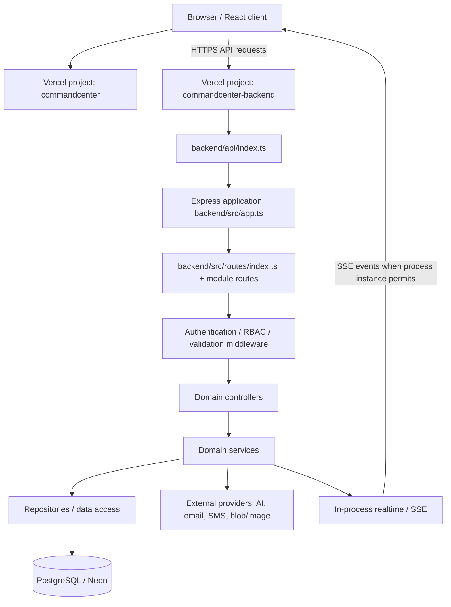

# CommandCenter — Comprehensive Technical Export of This Chat

**Export date:** 2026-10-19  
**Project:** CommandCenter  
**Primary repository:** `https://github.com/Rushi9234/CommandCenter`  
**Local workspace reported in this chat:** `D:\CommandCenter - Copy (2)`  
**Deployment target:** Vercel (frontend project `commandcenter`; backend project `commandcenter-backend`)  
**Runtime branch:** `vercel-runtime`  
**Important scope note:** This document captures the technical project context available in this conversation, with emphasis on the Git/GitHub/Vercel work and architectural notes supplied in the conversation history. It does **not** pretend to reproduce complete source files, SQL schemas, or source code that were never pasted into this chat. Where exact code/schema was not present, the limitation is recorded explicitly rather than invented.

---

## 0. Executive state / handoff summary

### 0.1 What happened in this chat

1. The local application had extensive implementation work in React/TypeScript and Express/TypeScript.
2. A broad Git staging set initially contained application code, audit/review documents, tests, migrations, environment templates, and QA/provisioning artifacts.
3. The user clarified a strict repository objective: GitHub should contain **only what is needed to build and run the production application on Vercel**, not review notes, markdown reports, roadmaps, current-state notes, tests, QA scripts, or local-only files.
4. Local commit `a69ca95` was created with message `chore: prepare minimal Vercel runtime repository`. It changed 167 staged paths (that is a commit/change count, not necessarily the complete checked-out tree count).
5. A normal push to `master` was rejected because GitHub `origin/master` had advanced to `5ce10b1`. No pull/reset/force-push was performed.
6. To protect the pre-existing GitHub `master`, commit `a69ca95` was pushed to a new branch, `vercel-runtime`.
7. An inspection of the GitHub branch then revealed that the first commit did not remove every file inherited from its parent tree. The Git index was cleaned with explicit `git rm --cached` operations. This retained those files on the local disk while staging their deletion from the Git tree.
8. Cleanup commit `274c288` was created with message `chore: remove non-runtime files from Vercel branch` and pushed to `vercel-runtime`.
9. GitHub tree browsing then showed only the root directories `backend/` and `frontend/` on `vercel-runtime`.
10. Vercel deployment screens showed Ready deployments for commit `274c288` under `vercel-runtime` in both `commandcenter-backend` and `commandcenter`. A promotion dialog was opened for the frontend and the user reported that the deployment showed Ready. The final active production alias was not conclusively confirmed from a final screenshot.
11. After that deployment, a frontend production-configuration gap was discovered: `frontend/postcss.config.js`, `frontend/tailwind.config.js`, and `frontend/vercel.json` had been removed from the Git tree as “non-runtime” files even though they are required for production styling/routing. Antigravity reported restoring and staging those three files, with a successful frontend build and whitespace check. That fix had **not** been committed, pushed, or redeployed by the end of the conversation.

### 0.2 Git state at the transition point

| Item | State established in the conversation |
|---|---|
| Local workspace | `D:\CommandCenter - Copy (2)` |
| Local branch name | `master` |
| Local `HEAD` | `274c288` (`chore: remove non-runtime files from Vercel branch`) before the last staged config-only fix |
| Remote GitHub `master` | `5ce10b1` after `git fetch origin`; it was not force-pushed or rewritten |
| Remote GitHub `vercel-runtime` | Verified with `git ls-remote` as `274c288b51bb1a35a9e7d09cffad572d884416d0` |
| Latest Vercel commit seen | `274c288` |
| Pending staged fix at the end | `A frontend/postcss.config.js`, `A frontend/tailwind.config.js`, `A frontend/vercel.json` according to Antigravity's report |
| Latest fix commit/push/deploy | None reported |
| Local files removed from Git tracking | Still present locally as untracked (`??`) files after using `git rm --cached` |
| Vercel end-to-end app behavior | Not verified by a completed login + API-backed workflow in the material available here |

**Immediate next step:** verify that the three frontend deployment-config files are staged and that no unrelated local files are staged; then get a fresh commit authorization before committing those exact three files, push `HEAD` to `vercel-runtime` only, and verify/redeploy both Vercel projects. Do not use `git add -A`, `git add .`, force-push, pull, reset, or clean in this workspace without deliberate review.

---

# 1. Executive project overview

## 1.1 Product intent

CommandCenter is a team/classroom work-coordination application that connects goals, tasks, evidence, work progress, notifications, team chat, work activity, and attention signals. It aims to give different roles useful views of shared work without exposing data from other teams or personal/shared scopes.

Major product capability areas reflected in the available project context:

- Authentication and account/profile workflows, including email-change and phone-verification phases.
- Team membership, team roles, invitations/join requests, and classroom/coordinator hierarchy.
- Projects and task collaboration/discovery.
- Goals and goal governance/review workflows.
- Goal → Task → Evidence linkage, including retained historical evidence/timeline behavior.
- Daily work/submissions and work-state history.
- Work transparency/activity logs and leader/team views.
- Work/Pulse feed and attention signals.
- Notifications and deep-link destinations.
- Direct/team chat with historical membership privacy.
- AI assistant endpoint based on explicitly user-supplied context, with context treated as untrusted.
- Avatar/profile image handling and cropping.
- Email and SMS provider abstractions.
- Analytics hierarchy for high-level overview, classes, teams, and members.

## 1.2 Architecture choice

**Architecture: modular monolith**, not microservices.

- The backend is one TypeScript/Express application organized into domain modules.
- Controllers, services, repositories, routes, middleware, configuration, and shared utilities are separated by responsibility.
- The same backend source tree supports ordinary server execution/building and a Vercel serverless API entrypoint.
- PostgreSQL is the relational persistence layer; Neon/PostgreSQL was the DB hosting context discussed.
- The frontend is a separate React/TypeScript/Vite app.
- Frontend and backend are deployed as distinct Vercel projects in the screens shared (`commandcenter` and `commandcenter-backend`).
- In-process realtime/SSE is the current known implementation, not a distributed broker-backed architecture.

The design favors explicit module boundaries and a single deployable backend rather than independently deployed microservices.

## 1.3 Technology stack supported by the conversation

### Frontend

- React + TypeScript.
- Vite for bundling and dev/build tooling.
- Tailwind CSS, via Tailwind configuration and PostCSS plugins.
- `frontend/index.html` as Vite's HTML entry.
- `frontend/vite.config.ts` as Vite config.
- TypeScript configuration files `frontend/tsconfig.json` and `frontend/tsconfig.node.json`.
- Frontend unit/component tests use Vitest and React Testing Library (based on earlier test reports and test files).
- Styling source includes `frontend/src/styles/index.css`.
- Frontend service/hooks/components/pages live under `frontend/src/`.

### Backend

Evidence in `backend/package.json` retrieved during the work includes these dependencies/scripts:

- Node.js + TypeScript.
- Express (`express` 4.x in the report’s package manifest).
- PostgreSQL client (`pg`).
- Authentication: `jsonwebtoken`, `bcrypt`.
- Request validation: `zod`.
- Middleware/security: `helmet`, `cors`, `cookie-parser`, `express-rate-limit`.
- Email: `nodemailer`, `resend` and an email provider factory.
- SMS abstraction and provider implementations, including console and MSG91 providers.
- AI provider abstraction with Groq and Gemini providers.
- Avatar/image support: `sharp`, `@vercel/blob`.
- `dotenv` is in dependencies, but production Vercel values should be injected via Vercel environment variables rather than relying on committed `.env` files.
- Build: `npm run build` → `tsc`.
- Local dev: `ts-node-dev --respawn --transpile-only src/server.ts`.
- Non-Vercel start script in package metadata: `node dist/server.js`.
- DB migrations package/script exists in the local package metadata: `node-pg-migrate`, `migrate:up`, `migrate:down`, `migrate:create`. However, the migration files were intentionally removed from the minimal runtime branch; migration application is therefore an out-of-band release/deployment responsibility unless the deployment architecture is changed.

### Deployment

- Vercel frontend project: `commandcenter`.
- Vercel backend project: `commandcenter-backend`.
- Backend Vercel entrypoint: `backend/api/index.ts`.
- Backend Vercel configuration: `backend/vercel.json`.
- Frontend Vercel SPA rewrite config is `frontend/vercel.json` and was found necessary enough to restore after it was removed.
- Frontend styling configs are `frontend/postcss.config.js` and `frontend/tailwind.config.js`; those were also restored/staged at the end of the chat.

## 1.4 Database platform: PostgreSQL, not MySQL or MongoDB

The project data in this conversation is PostgreSQL-oriented. `pg`, PostgreSQL/Neon connection URLs, SQL migrations, `node-pg-migrate`, and relational tables were all discussed. There is **no basis in this chat to document a MySQL or MongoDB configuration**. This export therefore does not invent one.

---

# 2. Architectural blueprint and system design

## 2.1 Deployment shape



This is a logical diagram from the known implementation shape, not a deployment manifest copied verbatim from source code. The actual Vercel settings (root directory, build/output fields, environment values, alias state) must be checked in the Vercel dashboard.

## 2.2 Backend module layering

Typical module layout follows the structure below (illustrative tree; exact files vary by module):

```text
backend/src/
  app.ts
  server.ts
  routes/
    index.ts
  common/
    dto-helpers.ts
    phone.ts
    middleware/
      errorHandler.ts
      requireConversationParticipant.ts
      requireTeamRole.ts
      validate.ts
    rateLimit/
      expressRateLimitProvider.ts
      rateLimitProvider.interface.ts
  config/
    env.ts
  controllers/
  middleware/
    auth.ts
  db/
    client.ts
  modules/
    ai/
    analytics/
    attention/
    auth/
    avatars/
    blockers/
    chat/
    dailyWork/
    goals/
    guidance/
    leaderboard/
    logs/
    notifications/
    projects/
    pulse/
    teams/
    users/
    workStateHistory/
    worklog/
  realtime/
  services/
    email/
    sms/
  utils/
```

### Controller/service/repository responsibility map

| Layer | Responsibilities |
|---|---|
| Routes | Map HTTP method/path to middleware and controller handlers; central route registration in `backend/src/routes/index.ts`. |
| Middleware | Authentication, team-role enforcement, conversation participation authorization, validation, rate limiting, common error response handling. |
| Controllers | Translate HTTP request/validated DTO into service calls; translate results/errors to HTTP responses. |
| DTO/validation | Define and validate incoming request shapes (Zod-backed validation is in the stack). |
| Services | Domain rules, workflow state transitions, membership checks, orchestration, event/notification side effects. |
| Repositories | SQL/database reads and writes; repositories are present in domains where query complexity/access policy benefits from isolation. |
| DB client | `backend/src/db/client.ts`, PostgreSQL connection-pool initialization. |
| Provider factories | Select AI/email/SMS provider implementations based on runtime configuration. |
| Realtime provider | In-process implementation; event delivery is not durable/distributed by the information available here. |

## 2.3 Authentication and authorization principles

- Backend authorization is authoritative. Frontend controls/hiding are only UX affordances and must not be relied upon for security.
- Requests should validate authenticated identity and membership/role server-side before reading/mutating team-scoped data.
- `requireTeamRole` is part of team-role enforcement.
- `requireConversationParticipant` protects chat conversation endpoints so only a conversation participant can access that conversation's messages/actions.
- Zod/validation middleware validates request payloads; malformed JSON was corrected to produce HTTP 400 rather than 500.
- Error handling is centralized in `backend/src/common/middleware/errorHandler.ts`.
- Rate limiting is abstracted through an interface and an Express-backed provider (`rateLimitProvider.interface.ts`, `expressRateLimitProvider.ts`).

## 2.4 Frontend navigation and route layout

The known user-facing routes/route groups are:

- `/work` and `/pulse`: unified work/pulse experience; user-facing label includes “Work Activity”.
- `/teams`: teams landing/list.
- `/teams/:teamId`: standard team page.
- `/classrooms/:teamId`: classroom/container route.
- `/analytics`: overview/analytics landing.
- `/analytics/classes/:classId`: class analytics.
- `/analytics/classes/:classId/teams/:teamId`: team analytics within a class.
- `/analytics/classes/:classId/teams/:teamId/members/:memberId`: member analytics within a class/team.
- Equivalent unparented-team analytics routes exist for teams not under a class hierarchy (exact path patterns beyond the routes above are not reproduced because the available context does not give all of them).

Analytics hierarchy agreed in the design context:

```text
Analytics
├── My Overview
├── My Progress
├── My Classes
│   └── Class
│       └── Team
│           └── Member
└── My Teams
    └── Team
        └── Member
```

Responsibilities are separated: class views can roll up teams and members; operational team pages are not intended to become a substitute for the entire analytics domain; Overview remains high-level.

## 2.5 Goal → Task → Evidence model

The known design establishes these relationships/semantics:

- Tasks may reference a goal via `goal_id` (a task-to-goal foreign key was added in a migration that exists locally but is not currently in the minimal Vercel branch tree).
- Task and goal association must be validated as belonging to the same team.
- Goal progress is a hybrid calculation/override workflow; exact formulas/column list are not available in this chat and should not be fabricated.
- `done` is interpreted as verified completion.
- `review` / `submitted` are in-flight workflow states rather than fully completed verified work.
- `changes_requested` transitions back to `in_progress`.
- Timeline/history preserves deleted-task evidence instead of losing the historical trace.
- `GoalDetailView` displays linked tasks, evidence, and timeline.
- Goal creation/review governance exists and is guarded by service/controller rules.

## 2.6 Chat V1 architecture

Chat scope and product constraints captured in the project context:

- Direct 1:1 chat and canonical team chat.
- Flat conversation model for V1.
- No attachments in V1.
- Do not claim end-to-end encryption (E2EE); this was explicitly not a supported claim.
- Moderation tools were excluded from V1 scope.
- Message retention is indefinite in V1; no automatic expiry is asserted.
- Team deletion cascades to team chat data according to the designed lifecycle.
- DMs are limited to users who share the current team (authorization rule from the implementation context).
- Messages are immutable in the V1 design.
- Tables: `conversations`, `conversation_participants`, `chat_messages`.
- A team participant read cursor is cached for read/unread handling.
- Realtime is in-process SSE; no durable distributed pub/sub broker is evidenced.
- Historical conversation/message access is membership-sensitive: a user must not see messages from before joining a team if the design's membership timeline rule disallows them.
- Server-side participant middleware is `requireConversationParticipant`.

## 2.7 Work transparency, Pulse and attention

Known work-transparency components include:

- Worklog API: `GET /api/teams/:id/worklog?limit=50`.
- Worklog query orchestration was bounded to six parallel queries and a maximum row limit of 100 per configured query path (the API's default query limit is 50 in the example above).
- Work-state history retains transitions for timeline/audit purposes.
- Pulse/attention aggregates explainable signals rather than a black-box score.
- Attention categories known from the implementation context:
  1. `UNRESOLVED_BLOCKER`
  2. `STALLED_TASK`
  3. `OVERDUE_TASK`
  4. `REOPENED_WORK_FLAPPING`
  5. `GOAL_PROGRESS_STALLED`
  6. `MISSING_DAILY_SUBMISSION`
  7. `PENDING_JOIN_REQUEST`
  8. `SUBTEAM_AT_RISK`
- Related components/services include `WorkPulseFeed`, `WorkActivityTimeline`, `TeamLeaderWorklogDashboard`, `AttentionActionCenter`, pulse service/repository/controller/routes, and workStateHistory module.
- User-facing navigation unifies Work/Pulse around “Work Activity”.

## 2.8 Projects and collaborators

The collaborator/discovery rules established in previous project work:

- Public unparented/personal projects can be discoverable; private projects are excluded from discovery.
- Accepted collaborators can perform permitted task writes.
- Project creators/owners retain owner capabilities, including approval/rejection and deletion where allowed.
- Accepted collaborators do not automatically receive all owner-only delete permissions.
- Frontend assignment candidates for an independent project include its owner and accepted collaborators.
- Backend access checks were expanded to recognize project creator, eligible non-viewer team member, accepted collaborator, and task owner/creator according to the operation.
- Collaborator approval/rejection may trigger notifications and deep links.

## 2.9 Classroom/team ownership regression

A class ownership bug was traced to a discriminator mismatch:

- Service queried `team_type='classroom'`.
- Persisted DB values used `team_type='class'`.
- The query was fixed to support `class`/`classroom` where needed.
- Classroom containers were excluded from ordinary “my teams” listing.
- Class IDs were prevented from being treated as standard team analytics IDs.
- The fix did not require a DB write/schema mutation.

## 2.10 AI governance and data boundaries

Known AI contract:

- Endpoint: `POST /api/ai/chat`.
- Request body fields: `message`, optional `context`, optional `teamId`.
- When `teamId` is provided, the service checks active membership.
- The `context` is user-supplied/client-supplied context, **not** authoritative server-side DB retrieval.
- No RAG/vector search is implemented/evidenced in this V1 scope.
- Prompts treat supplied context and messages as untrusted input.
- PII masking exists in the described flow.
- Classroom scope is not supported in the AI context path described here.
- Provider abstraction includes Groq and Gemini; configuration/factory chooses provider.

## 2.11 Realtime boundary

- In-process SSE is the current implementation.
- It may work across requests landing on the same process, but should not be described as globally durable or cross-instance guaranteed without a shared broker/backplane.
- The minimal Vercel runtime deployment may run many serverless instances; therefore realtime semantics need operational verification in a real deployed multi-instance environment before claiming robust cross-user realtime behavior.

---

# 3. Core system components and codebase seeds

## 3.1 Repository layout in the final GitHub `vercel-runtime` branch

The GitHub tree was verified after commit `274c288` to have only these root entries:

```text
/
├── backend/
└── frontend/
```

The cleaned Git tree intentionally excluded root documentation and development files; it did **not** mean those files were wiped from the Windows working folder.

### Backend repository layout

```text
backend/
  api/
    index.ts
  package.json
  package-lock.json
  tsconfig.json
  vercel.json
  src/
    app.ts
    server.ts
    common/
    config/
    controllers/
    db/
      client.ts
    middleware/
    models/
    modules/
    realtime/
    routes/
    services/
    utils/
```

The folder names above summarize the project structure known from the chat. The exact leaf-file listing is not fully represented in this export.

### Frontend repository layout

```text
frontend/
  index.html
  package.json
  package-lock.json
  tsconfig.json
  tsconfig.node.json
  vite.config.ts
  src/
    App.tsx
    main.tsx
    vite-env.d.ts
    styles/
      index.css
    components/
    hooks/
    pages/
    services/
    utils/
    assets/
```

**Important late correction:** `frontend/postcss.config.js`, `frontend/tailwind.config.js`, and `frontend/vercel.json` were restored and staged after commit/push `274c288`, because their removal caused a production deployment-configuration concern. They were not yet part of a new commit/push/deployment at the end of the chat. They should be considered required configuration, not documentation-only files.

## 3.2 Backend package scripts

The backend package manifest inspected during the work contained these scripts (as reported from `backend/package.json`):

```json
{
  "scripts": {
    "dev": "ts-node-dev --respawn --transpile-only src/server.ts",
    "build": "tsc",
    "start": "node dist/server.js",
    "migrate:create": "node-pg-migrate create --migration-file-language sql --",
    "migrate:up": "node-pg-migrate up",
    "migrate:down": "node-pg-migrate down",
    "cleanup:refresh-tokens": "ts-node --transpile-only src/jobs/cleanupRefreshTokens.ts",
    "test": "jest --runInBand --forceExit",
    "test:watch": "jest --runInBand --watch"
  }
}
```

The actual Vercel serverless deployment uses `backend/api/index.ts` and `backend/vercel.json`; do not assume the normal `start` script describes how Vercel serves requests. Verify the Vercel project root-directory and build settings independently.

## 3.3 Backend Vercel entrypoint

Known files:

- `backend/api/index.ts`: Vercel serverless handler/entrypoint.
- `backend/vercel.json`: serverless routing/configuration.
- `backend/src/app.ts`: Express app construction and middleware/routes.
- `backend/src/server.ts`: normal Node server entry (used by `dev`/`start` scripts).

The full contents of these files were not pasted in this chat. Therefore this export does not invent the exact `module.exports`/handler wrapper, rewrite syntax, timeout setting, or route map in the JSON config.

## 3.4 Frontend production build configuration

The late configuration audit found the following files had been mistakenly excluded from the runtime branch and needed to be restored:

### `frontend/postcss.config.js`

Purpose reported by Antigravity: configure PostCSS plugins (`tailwindcss` and `autoprefixer`) so Vite processes Tailwind CSS classes for the production stylesheet.

The exact file content was not included in the report, so it is not reproduced verbatim here.

### `frontend/tailwind.config.js`

Purpose reported by Antigravity: Tailwind content paths include:

- `./index.html`
- `./src/**/*.{js,ts,jsx,tsx}`

It also configures the design system's primary palette, fonts, shadows, and keyframe animations. Exact token values and source are not available here.

### `frontend/vercel.json`

Purpose reported by Antigravity: SPA client-side rewrite:

```json
{
  "rewrites": [
    { "source": "/(.*)", "destination": "/index.html" }
  ]
}
```

This is the structure reported in the deployment-config fix. Confirm the actual staged file in the workspace before reusing it as a literal source artifact.

## 3.5 PostgreSQL schema and migrations

### Database platform

- PostgreSQL is the explicit relational DB technology.
- Neon/PostgreSQL was the hosted DB context.
- Backend connections use `pg` via `backend/src/db/client.ts`.
- Connection details should be supplied as environment values; real production credentials must not be stored in the repo.

### Schema information actually known

The chat context names the following tables as part of application/QA state:

- `users`
- `teams`
- `team_members`
- `projects`
- `project_collaborators`
- `tasks`
- `goals`
- `blockers`
- `daily_logs`
- `submissions`
- a history/work-state-history structure
- `conversations`
- `conversation_participants`
- `chat_messages`
- `notifications`
- `join_requests`
- `invites`

These names are not a substitute for the full actual SQL schema. Full table definitions, types, constraints, indexes, and migration contents were not included in this user turn; they cannot be reconstructed safely from table names alone.

### Migration strategy and critical deployment caution

- The backend package contains `node-pg-migrate` scripts (`migrate:up`, `migrate:down`, etc.).
- The minimal Vercel runtime branch deliberately excludes `backend/migrations/**` and `database/schema.sql` under the user's strict “runtime files only” rule.
- This means a fresh/empty database cannot be assumed to be initialized by the runtime branch.
- An existing DB must already have all required tables, columns, and indexes, or migrations/schema must be managed through a separate controlled release path outside this minimal branch.
- Before production rollout or use with a fresh DB, restore/manage schema and migrations securely in an operations/migration repository or other controlled deployment workflow. Do not run seed/reset scripts against production.

### Destructive QA seed warning

`backend/scripts/seedRichQAData.ts` / `backend/src/db/provisionRichQA.ts` / related QA provisioning scripts were identified as destructive or QA-only. A rich QA seed had previously truncated/recreated tables and removed original local QA data, including an `Akash` entry in that DB. Neon point-in-time recovery/branch/snapshot before approximately `2026-09-17 18:29 IST` was identified as the likely recovery route. **Do not rerun rich QA seeds or reset scripts.** This is a historical project context item; recovery should be handled carefully against the actual DB provider and snapshot state.

## 3.6 Environment-variable model

The repo had historically contained several templates/config files that were scrubbed and then intentionally excluded from the minimal branch:

- `.env.example`
- `backend/.env.example`
- `backend/.env.test.example`
- `backend/.env.docker`

During cleanup, staged values were checked for five keys:

- `DATABASE_URL`
- `REDIS_URL`
- `MONGODB_URL`
- `JWT_SECRET`
- `GROQ_API_KEY`

All five in the staged `backend/.env.docker` were ultimately reported as local placeholders/example values; `GROQ_API_KEY` had initially failed the scanner and was replaced with `your_groq_api_key_placeholder` and re-staged. Other templates were reported to contain placeholders/local examples.

No actual secret values are reproduced here. One real Neon DB credential had been pasted in prior script content and must be treated as compromised; rotate it before production/GitHub use. Do not put that value into this export.

### Production environment principles

- Vercel production secrets should be configured in Vercel Project Settings → Environment Variables.
- Do not expect `.env.example` or `.env.docker` to be read automatically by Vercel at runtime.
- Required/optional environment keys should be confirmed from `backend/src/config/env.ts` and the provider factories.
- Likely relevant settings discussed by name include `DATABASE_URL`, `JWT_SECRET`, AI provider key (e.g. `GROQ_API_KEY`), and provider credentials for email/SMS/blob storage. This list is indicative, not an authoritative complete `.env` contract.
- `REDIS_URL`/`MONGODB_URL` appeared in the scanner pattern; their actual use was not established as part of this chat and they should not be added to production unless the application explicitly requires them.

## 3.7 Core API contracts known from the chat

### AI assistant

```http
POST /api/ai/chat
Content-Type: application/json
```

Known body fields:

```json
{
  "message": "string",
  "context": "optional user-supplied context",
  "teamId": "optional team identifier"
}
```

Semantics and safeguards:

- `message` is the user's prompt.
- `context` is supplied by the client and must be treated as untrusted data, not as an authoritative server read of project records.
- Optional `teamId` triggers an active membership check.
- Prompt instructions treat the incoming context/message as untrusted and include PII masking in the described flow.
- No vector database, embedding store, or RAG-based authoritative retrieval was represented in this V1 scope.
- Classroom-scoped AI context was not supported in the known flow.

### Team worklog

```http
GET /api/teams/:id/worklog?limit=50
```

Known constraints:

- Default/example limit: 50.
- Service executes at most six bounded parallel queries in the described implementation.
- Individual query/collection limits are bounded (maximum 100 in the project context).
- Treat this as a bounded read model, not an unlimited audit dump.

### Analytics routes

```text
/analytics
/analytics/classes/:classId
/analytics/classes/:classId/teams/:teamId
/analytics/classes/:classId/teams/:teamId/members/:memberId
```

Additional equivalent analytics routes exist for teams outside a classroom hierarchy, but the exact paths were not recorded in the context available here.

### Team/work/chat routes

- `/work` / `/pulse`
- `/teams`
- `/teams/:teamId`
- `/classrooms/:teamId`

The full HTTP method + endpoint inventory was not supplied in this chat. Do not infer a complete route list from file names.

## 3.8 Table / dataset snapshot from historical QA work

A synthetic rich-QA topology was described before this Git/deployment work. It is included as test-context evidence, not production data:

- 14 synthetic users: Rush, Raju, Sham, Amit, Neha, Pooja, Kiran, Ravi, Sita, Mohan, Nikhil, Priya, Arun, Vikram.
- Test emails followed `name@commandcenter.local`.
- Three classes A/B/C.
- Twelve class teams A1–A4, B1–B4, C1–C4.
- Three unparented teams X/Y/Z.
- `team_members`: 61 rows.
- Pooja is in A1, B2, and X in the test topology.
- The data seed had Rush as owner of all class teams despite an earlier desired topology; note that as a test-data limitation, not intended production access policy.
- Earlier post-seed forensic counts: users 14, teams 18, team_members 61, projects 18, project_collaborators 4, tasks 49, goals 19, blockers 9, daily_logs 24, submissions 55, history 42, conversations 1, chat messages 5, notifications 6, join_requests 0, invites 0.
- Password hashes were audited as bcrypt cost 12 with no plaintext/hash exposure in read responses; avoid embedding QA passwords in repo or documentation.
- Chat historical privacy test scenario: Pooja joined A1 two days earlier and Rush ten days earlier; Rush could see pre-join messages while Pooja only saw permitted post-join content under that test rule.
- Project scope privacy scenario: Rush viewing Pooja in team A1 only sees A1 tasks, not Pooja's B2/X tasks or personal-project scope.
- Mutation isolation scenario: Raju changing task status in A1 updated A1 and not B2.
- Accepted collaborators could write permitted task data without gaining owner-only project/task deletion rights.

## 3.9 Exact file names / code areas changed in implementation history (where known)

The Git output from commit `a69ca95` reported newly introduced runtime code such as:

- Backend: `backend/api/index.ts`, conversation participant middleware, phone utility, Gemini provider, analytics and attention modules, avatar module, chat module, guidance module, notifications, pulse, user DTOs, work-state history, worklog, in-memory realtime provider, SMS providers/service.
- Frontend: assign-work/assigned-to-me components, attention action center, classroom coordinator dashboard, goal details, guidance banner, member detail view, notification bell, guidance/review modals, quick overview, sidebar/spotlight tour/team leader worklog dashboard, work activity and pulse feed, charts, chat components/page, common avatar/search/status/selector components, hooks for unread chat/realtime/overview/teams guide, overview/profile/verify-email-change pages, guidance/pulse/realtime/timeline services, avatar/crop/date/hierarchy utilities.

This is not intended as an exhaustive path list; Git itself is the source of truth for the exact tree at each commit.

---

# 4. Edge cases, regressions, troubleshooting and fixes

## 4.1 Git history divergence and safe push strategy

### Symptoms

Normal push was rejected:

```text
! [rejected] master -> master (fetch first)
error: failed to push some refs
remote contains work that you do not have locally
```

`git fetch origin` advanced `origin/master` from `f15ab3a` to `5ce10b1`. Local `HEAD` was `a69ca95` and had diverged from remote history. GitHub remote commits included security placeholder cleanups and earlier product changes.

### Resolution

- Did not run `git pull`, `git reset --hard`, or force-push.
- Created/pushed a separate branch by using the existing local commit:

```cmd
git push origin HEAD:vercel-runtime
```

Remote verified:

```text
a69ca95b653553ab1a1db77f6f34965294c14271 refs/heads/vercel-runtime
```

- This preserved the existing GitHub `master` branch.

## 4.2 Why the first “minimal runtime” commit still showed Markdown and setup files on GitHub

A crucial Git distinction was uncovered:

- A commit showing `167 files changed` does not imply its entire resulting tree contains only those 167 files.
- A commit based on a history that already tracks files inherits parent-tree paths unless those paths are explicitly deleted from the Git tree.
- Browsing `vercel-runtime` after `a69ca95` showed `.github/`, Markdown files, `docker-compose.yml`, `database/`, and setup scripts still present.

This led to an explicit tracked-file cleanup using `git rm --cached` rather than deleting the physical working-tree files.

## 4.3 Preserve local files while removing them from Git

The cleanup commit reported `delete mode 100644 ...` for 97 paths. Afterward, `git status --short` showed the files as untracked (`??`), and `dir README.md`, `dir DATABASE_SETUP.md`, and `dir backend\tests` proved those files still existed on disk.

This confirms the intended operation:

- Git index/tree: files removed from the runtime branch.
- Local disk: files preserved, now untracked.

Do not run `git clean` to “fix” the untracked state; that would risk deleting the preserved local artifacts.

## 4.4 Whitespace-check failures and cleanup process

`git diff --cached --check` initially failed across many newly staged Markdown/source files due to trailing whitespace and whitespace on blank/end-of-file lines. Early Python cleanup commands did not work reliably; one reported `CLEANED_AND_RESTAGED: 0` because its comparison logic was flawed. Further attempts were made with Antigravity instead.

Antigravity later reported:

- 295 staged files inspected in one intermediate stage.
- 24 files had whitespace/EOF cleanup.
- Content modifications: 0, according to the report.
- `git diff --cached --check`: PASS.
- Excluded QA files: none staged.

A later staging reset/allowlist process brought the change set to the minimal runtime approach. Do not treat the intermediate 295-file count as the final repository file count.

## 4.5 Staged environment template scanner caught a non-placeholder AI key

A targeted staged check initially printed:

```text
DATABASE_URL: PLACEHOLDER/LOCAL
REDIS_URL: PLACEHOLDER/LOCAL
MONGODB_URL: PLACEHOLDER/LOCAL
JWT_SECRET: PLACEHOLDER/LOCAL
GROQ_API_KEY: NON-PLACEHOLDER — FIX REQUIRED
```

The local file was changed to a placeholder (`GROQ_API_KEY=your_groq_api_key_placeholder`) and re-staged. The subsequent staged check reported all five values as placeholder/local. The final runtime branch later excluded `.env.docker` and `.env.example` files altogether.

## 4.6 Secret handling

- High-confidence secret scans and database-URL scans were reported as passing at the final staging gate.
- A real Neon DB credential had been pasted in previous scripts, so it was marked compromised in the project context and requires rotation.
- Do not ever reintroduce real connection URLs into docs, examples, or Git history.
- Environment values belong in Vercel Project Settings and local secret files that remain excluded/ignored from version control.
- If a credential has ever landed in a public commit, replacing the text in a later commit is not sufficient to revoke it; rotate the credential first.

## 4.7 Removal of build-critical files was a false “minimal runtime” classification

Antigravity removed these frontend files while enforcing a very strict non-runtime exclusion:

- `frontend/postcss.config.js`
- `frontend/tailwind.config.js`
- `frontend/vercel.json`

A subsequent report explicitly identified them as production deployment config, restored and staged them, and ran a successful frontend build. The SPA rewrite is required for client-side route refresh/deep-links; PostCSS/Tailwind config controls CSS generation/theme/content scanning.

**Critical handoff:** those three files were staged, not yet committed/pushed/deployed. The existing `274c288` remote tree therefore still lacks them. Do not call the frontend deployment fully correct until these files have been committed/pushed to `vercel-runtime` and the frontend is redeployed/verified.

This is a broader lesson: “only runtime files” does not mean “only `.ts/.tsx`”. Build configuration, CSS processing configuration, static HTML entrypoints, Vercel routing manifests, and the files those configs consume can be essential to production runtime.

## 4.8 Vercel status: Ready versus Production

Vercel deployment lists showed rows for `274c288` and `a69ca95` on `vercel-runtime` marked **Ready**, with a **Preview** badge visible in at least one screenshot. A production promotion dialog for `274c288` on frontend project `commandcenter` was opened and showed alias `commandcenter-sand.vercel.app`; the user reported the deployment later showed Ready.

Important distinction:

- “Ready” means the deployment finished successfully.
- “Ready” alone does not prove that the deployment is the active Production alias.
- A final screenshot confirming the 274c288 deployment’s Production badge/domain was not provided in the available record.
- The project was later found to need the three frontend config files, which were not yet redeployed at the end of the conversation.

Therefore the safest truth is: deployments for `274c288` were Ready, a promotion was initiated, but final production alias status and end-to-end behavior should be reverified after the three configuration files are committed and deployed.

## 4.9 Class/classroom discriminator mismatch

Regression:

- The service filtered for `team_type='classroom'`.
- Stored values use `team_type='class'`.

Fixes recorded:

- Query logic supports real persisted discriminator values.
- Classroom containers should not appear as ordinary operational teams.
- Class identifiers should not pass as normal team analytics identifiers.
- No DB data/schema mutation was required for the code fix.

## 4.10 Project collaborator authorization inconsistency

Observed/verified behavior after the fix:

- Backend project/task access can recognize the creator/owner, eligible team member, accepted collaborator, and task owner/creator where appropriate.
- Frontend independent project assignee list includes project owner + accepted collaborators.
- Accepted-collaborator badge/status exists.
- Delete is gated on frontend and backend, and an accepted collaborator doesn't automatically gain owner delete rights.
- Targeted collaboration tests were reported as passing.

## 4.11 Historical chat privacy

The design disallows arbitrary access based solely on knowing a conversation ID. Conversation participants and membership timeline are involved in authorization. The service should not disclose past messages that are outside the user's permitted timeline. Historical privacy was checked with users who joined a shared team at different times.

## 4.12 API malformed JSON status

Malformed JSON originally produced a server error response (500) in a hardened validation flow. It was corrected to return a client error (400). This is the expected semantic class for a malformed client payload.

## 4.13 Realtime scaling limitation

Because the known event provider is in-process SSE, successful local tests do not prove cross-instance event distribution in Vercel serverless. Future design must either accept that limitation explicitly or introduce a shared pub/sub/backplane and test multi-instance delivery. Do not claim guaranteed global realtime without proving it.

---

# 5. Continuous Integration and Build Systems

## 5.1 Purpose and reliability contract

The build system must prevent source that cannot compile from being published as a production deployment. A Vercel deployment marked `Ready` proves that the platform completed its deployment process; it does not independently prove that every runtime route, database operation, authorization rule, or user workflow is healthy. CommandCenter therefore treats these as separate gates:

1. **Static correctness:** TypeScript compilation, module/export resolution, linting where configured, and configuration validation.
2. **Automated correctness:** unit/integration tests for changed modules, authorization, validation, and regressions.
3. **Artifact correctness:** frontend bundle generation and backend serverless output/configuration.
4. **Deployment correctness:** expected Git SHA, project root, build configuration, and deployment alias.
5. **Runtime correctness:** safe smoke tests against deployed endpoints and browser workflows.

A green result in one gate must not be described as a pass for all other gates.

## 5.2 Known build commands and package boundaries

The repository contains separate frontend and backend package roots. Run commands from the correct directory and record the exit code, not just the last console line.

### Frontend

```bash
cd frontend
npm ci
npm run build
```

The reported frontend production build runs TypeScript checking and Vite bundling (`tsc && vite build`). A successful run was reported as 531 modules transformed and a build time of approximately 12.99 seconds during the October 2026 recovery work. This is historical evidence for that code state, not a guarantee about future commits.

### Backend

```bash
cd backend
npm ci
npx tsc
npm test -- tests/feedback.test.ts
```

The backend package scripts reported in the source export include:

```json
{
  "scripts": {
    "dev": "ts-node-dev --respawn --transpile-only src/server.ts",
    "build": "tsc",
    "start": "node dist/server.js",
    "migrate:create": "node-pg-migrate create --migration-file-language sql --",
    "migrate:up": "node-pg-migrate up",
    "migrate:down": "node-pg-migrate down",
    "cleanup:refresh-tokens": "ts-node --transpile-only src/jobs/cleanupRefreshTokens.ts",
    "test": "jest --runInBand --forceExit",
    "test:watch": "jest --runInBand --watch"
  }
}
```

The actual Vercel backend execution path is the serverless entrypoint (`backend/api/index.ts`) and `backend/vercel.json`; it is not necessarily the same as `node dist/server.js`.

## 5.3 The October 2026 Vercel TypeScript failure

The frontend and backend deployment logs provided in the conversation exposed several compile/runtime consistency defects. The important rule is that TypeScript compilation, JavaScript runtime exports, and the deployed commit must agree.

### Frontend failure: missing date utility export

Reported build error:

```text
src/pages/AdminDashboard.tsx(5,10): error TS2305:
Module '../utils/dateUtils' has no exported member 'formatRelativeTime'.
```

Root cause reported by the coding agent: `AdminDashboard.tsx` imported `formatRelativeTime`, but the implementation in `frontend/src/utils/dateUtils.ts` had not been included in the earlier commit. The fix added/exported `formatRelativeTime(isoString: string | null | undefined): string` in `dateUtils.ts` and committed it as `bca9cbd` (`bca9cbdd9b3801e471d21f2b6ad11cdf1ec013ac`). The report says frontend build passed afterward.

### Backend build errors observed in Vercel logs

The logs reported:

```text
src/routes/index.ts(51,66): error TS2339: Property 'getMe' does not exist on type 'typeof import(".../authController')".
src/controllers/helpController.ts(2,10): error TS2305: Module '../modules/ai/rag/helpRagService' has no exported member 'getHelpDocsList'.
src/modules/feedback/feedback.service.ts(3,10): error TS2724: '../../services/emailService' has no exported member named 'sendSupportNotificationEmail'.
src/modules/feedback/feedback.service.ts(164,39): error TS2339: Property 'supportEmail' does not exist on the config type.
src/modules/feedback/feedback.repository.ts(3,10): error TS2305: Module '../../common/errors' has no exported member 'ServiceUnavailableError'.
```

The agent report attributes these to imports/routes referencing missing exports and configuration members in the remote repository. A follow-up commit, reported as `f2eff6de2e290b28632f983182cc3db8c60a0078` (`f2eff6d`), claimed to restore the missing controller/service/error exports, configuration entry, and error handling. The report listed 15 changed files and 245 insertions / 30 deletions. This report is an engineering activity record, not independent proof that each behavior is correct.

### Why a deployment can appear to complete despite TypeScript errors

The supplied log showed TypeScript diagnostics and later `Build Completed` / `Deployment completed` messages. This is a configuration inconsistency that must be diagnosed rather than ignored. Possible explanations include multiple projects/build configurations, a custom `builds` array overriding dashboard settings, an output that does not depend on the failing command, or logs from different deployment phases. The exact cause was not established conclusively in the conversation.

The backend fix reportedly added a `vercel-build` script that runs `tsc`, intending to make type errors block deployment. Confirm the actual Vercel project root and command behavior. A script name alone is not proof Vercel invokes it. Verify from fresh deployment logs that the expected check runs and that an intentionally failing check would fail in a safe preview branch—not by introducing a broken production commit.

## 5.4 CI workflow inventory and master-branch failures

The source export records a Git push rejection to `master` because `origin/master` had advanced. It does **not** contain the complete contents or names of GitHub Actions workflow files, raw CI run logs, or a definitive diagnosis of every historical `master` workflow failure. Consequently, this document does not invent workflow filenames, trigger definitions, job matrices, runner versions, or environment overrides.

Required workflow inventory for a future repository audit:

- Enumerate tracked `.github/workflows/*.yml` and `.yaml` files from the exact target commit.
- Record each workflow's trigger (`push`, `pull_request`, manual dispatch, schedule), branch filters, permissions, concurrency, job dependencies, Node version, package-manager/cache strategy, and required secrets by **name only**.
- Capture each failing run URL, commit SHA, job/step, command, exit code, and first causal error.
- Distinguish branch-protection failure, workflow syntax failure, dependency-install failure, typecheck/test failure, deployment-provider failure, and flaky external dependency.
- Do not document an inferred failure as a confirmed root cause.

Recommended baseline workflow checks are `npm ci`, frontend build, backend `tsc`, backend tests, staged secret scan, whitespace check, and configuration validation. Run DB integration tests only against an isolated test database. Do not point automated test jobs at production.

## 5.5 Environment-variable overrides and precedence

The project uses `backend/src/config/env.ts` as a runtime configuration boundary. Vercel environment variables should be set through the relevant Vercel project's settings for the intended environment (Development, Preview, Production). The source export names `DATABASE_URL`, `JWT_SECRET`, `GROQ_API_KEY`, and provider settings as examples of configuration names encountered; it explicitly does not contain a complete authoritative variable contract.

Operational rules:

- Treat environment values as secrets even when their names are not sensitive.
- Do not log values; log only whether a required variable is present and valid.
- Keep frontend public variables separate from backend-only secrets. Anything compiled into a browser bundle must be treated as public.
- Never use a local `.env` file as proof that Vercel has the same value.
- Record the target environment and variable **name** when diagnosing a mismatch, never the secret value.
- Do not add unused `REDIS_URL` or `MONGODB_URL` merely because they appeared in a historical scanner; their use was not established.
- If configuration is changed, verify both the deployment's environment scope and whether a new deployment is required for the change to take effect.

## 5.6 Build-system hardening checklist

- [ ] Frontend and backend package roots are explicit.
- [ ] Lockfiles are tracked and `npm ci` is reproducible.
- [ ] TypeScript checks run in the same build path used by Vercel.
- [ ] Vite production build runs after typechecking.
- [ ] Missing named imports/exports fail before deployment.
- [ ] Unit tests cover each repaired service/controller path.
- [ ] CI reports the exact SHA and command exit codes.
- [ ] Secret scans inspect staged changes and commit diffs without printing values.
- [ ] Production database integration tests are prohibited by default.
- [ ] Deployment status is not equated with end-to-end health.

---

# 6. Cloud Deployment and Platform Lifecycle

## 6.1 Current deployment topology

The known deployment arrangement uses two separate Vercel projects:

| Project | Responsibility | Source root / entrypoint noted in the conversation |
|---|---|---|
| `commandcenter` | React/Vite frontend | `frontend/`; `frontend/index.html`, Vite config, and SPA rewrite configuration |
| `commandcenter-backend` | Express/TypeScript API | `backend/`; `backend/api/index.ts`, `backend/vercel.json` |

Known domains mentioned in the conversation:

- Frontend canonical alias: `https://commandcenter-sand.vercel.app`
- Backend canonical alias: `https://commandcenter-backend.vercel.app`

Direct deployment URLs and branch aliases are deployment-specific and can change. The canonical aliases and deployed SHA must be checked in Vercel rather than inferred from a deployment list.

## 6.2 Frontend build and static routing path

The frontend is a React/TypeScript application bundled by Vite. The production artifact is static output (typically Vite's `dist/`, subject to the actual project config). `frontend/vercel.json` was reported to contain an SPA fallback rewrite:

```json
{
  "rewrites": [
    { "source": "/(.*)", "destination": "/index.html" }
  ]
}
```

The exact committed file must be checked before relying on this literal. This rewrite is important because routes such as `/help-center`, `/my-feedback`, `/admin/tickets`, `/teams/:teamId`, and nested analytics pages are handled client-side. Without a fallback, the app may work when navigating from the homepage but return a platform 404 when a user refreshes or directly opens a nested route.

The following configuration files were mistakenly removed in an earlier “runtime-only” cleanup and later reported restored/staged locally:

- `frontend/postcss.config.js`
- `frontend/tailwind.config.js`
- `frontend/vercel.json`

The original handoff said these files were staged but not yet committed/pushed at that time. Later reported commits and deployment logs must be used to establish their current state; do not treat the historical pending state as current without checking Git.

PostCSS/Tailwind configuration is production-critical because it determines CSS processing, utility generation, content scanning, and theme tokens. “Runtime-only” repository pruning must preserve every required build input, not only `.ts` and `.tsx` files.

## 6.3 Backend serverless path

The known backend path is:

```text
Vercel request
  -> backend/api/index.ts
  -> Express application (backend/src/app.ts)
  -> backend/src/routes/index.ts and module routes
  -> middleware / controller / service / repository
  -> PostgreSQL and provider adapters
```

`backend/src/server.ts` is used for ordinary Node development/start scripts. It should not be assumed to be the entrypoint used by Vercel. Inspect `backend/vercel.json`, Vercel's project root directory, build output, and any `builds` configuration before debugging a mismatch. A Vercel warning in the logs said that because `builds` exists in the configuration, dashboard Build and Development Settings would not apply. This warning is important: configuration-as-code can override settings shown in the dashboard.

## 6.4 Deployment sequence and gates

For each release:

1. Identify the intended branch and commit SHA.
2. Confirm the local working tree and staged file list.
3. Run frontend build, backend typecheck/build, and relevant tests.
4. Run `git diff --check` and a secret scan over the intended diff.
5. Review exact commit range against the target remote branch.
6. Push normally to the authorized branch; never force-push as a recovery shortcut.
7. Confirm Vercel picked up the expected SHA for both projects.
8. Inspect build logs independently for frontend and backend.
9. Verify deployment state and production alias separately; `Ready` can be a Preview deployment.
10. Run safe smoke tests against canonical aliases.
11. Observe fresh logs for 500/502/503/504 responses, timeouts, and missing-export errors.
12. If a deployment is unhealthy, identify the last known-good deployment and use Vercel's supported rollback/promotion procedure. Do not rewrite Git history to simulate rollback.

## 6.5 Recent Vercel incident timeline

### A. Missing `AdminDashboard` component

The frontend build failed with `TS2307: Cannot find module './pages/AdminDashboard'` from `frontend/src/App.tsx`. The report said `AdminDashboard.tsx` existed locally but was untracked and omitted from the earlier commit. The component was added in commit `5018abb` (`fix(frontend): add missing AdminDashboard page component`). This illustrates that a successful local build only applies to files present in the local working tree; it does not prove the files were committed.

### B. Missing `formatRelativeTime` export

After the component was committed, the Vercel frontend build failed with `TS2305` because `dateUtils.ts` did not export `formatRelativeTime`. The reported fix was committed as `bca9cbd` and pushed to `vercel-runtime`.

### C. Backend missing exports/configuration

The supplied Vercel logs then showed TypeScript errors for `getMe`, `getHelpDocsList`, `sendSupportNotificationEmail`, `supportEmail`, and `ServiceUnavailableError`. The same deployment logs also showed runtime 500s for Help Center and feedback endpoints, which means the missing members were not merely cosmetic compile warnings: deployed JavaScript called functions that did not exist in the runtime module exports.

A subsequent report says commit `f2eff6d` restored those members and changed 15 backend files. Both frontend and backend deployments were reported `Ready` for that SHA. This should be treated as a reported deployment milestone; successful post-deployment endpoint and browser tests were not included in that report.

### D. Vercel output that showed TypeScript errors but still deployed

The pasted build log contained TypeScript errors and then `Build Completed` / `Deployment completed`. This must be investigated in the current Vercel project configuration. Verify the exact build command, root directory, `vercel.json`, `builds` behavior, and which project generated the log. A deployment should not be approved if its expected typecheck fails, even if Vercel can package some output.

## 6.6 Production 500s and exact reported runtime causes

Vercel logs included these failures:

```text
POST /api/feedback -> 500
TypeError: (0, emailService_1.sendSupportNotificationEmail) is not a function

GET /api/help/docs -> 500
TypeError: (0, helpRagService_1.getHelpDocsList) is not a function
```

The corresponding requests included request IDs in the original logs; those IDs should be used to correlate server-side logs, but should not be treated as proof of fix. The missing-export causes were reported as addressed in `f2eff6d`. Verify with fresh requests and fresh log timestamps after the deployment SHA is confirmed.

Do not repeatedly submit the feedback form while it is failing. The request may partially persist a ticket before a notification side effect fails, depending on transaction boundaries. First inspect the service's transaction and error-handling behavior; use a test database for write-path testing.

## 6.7 Realtime SSE timeout and reconnect lifecycle

The production logs showed `/api/realtime/events` connections reaching a 300-second Vercel runtime timeout. The implementation uses Server-Sent Events (SSE) and a heartbeat. The agent report says a 45-second maximum stream lifetime was added for Vercel, after which the server sends a reconnect comment and closes the stream; browser `EventSource` is expected to reconnect.

This is a mitigation for the function duration limit, not proof of durable realtime delivery. It must be verified for:

- Client reconnect after server-side close.
- Authentication and authorization on each new connection.
- Cleanup of event listeners/timers when a client disconnects.
- No duplicate event processing.
- Last-event/replay behavior if a user is offline during an event.
- Correct CORS/cookie behavior on the canonical domains.
- No unexpected request amplification or excessive open connections.

The current design is in-process. Events emitted in one serverless instance are not automatically broadcast to another instance. For reliable cross-instance delivery, introduce a shared event broker or durable polling/read model in a separate planned change; do not claim that native EventSource reconnect alone solves distributed event delivery.

## 6.8 Deployment debugging checklist

When a deployment fails or the UI displays `Internal server error`:

1. Capture the exact canonical URL, HTTP method/path, status, timestamp, and request ID.
2. Inspect the matching backend runtime log and the frontend browser Network panel.
3. Verify the deployment's SHA and environment (Preview vs Production).
4. Compare the caller's imported symbol with the actual exported symbol.
5. Check whether an error occurs before DB access, during a transaction, or in a notification/provider side effect.
6. Check route registration and middleware order.
7. Verify required config keys exist without printing their values.
8. Run `npx tsc` from the backend root and `npm run build` from the frontend root.
9. Verify the Vercel build is running the same checks.
10. Test against a safe test DB or with a read-only request; do not mutate production data during diagnosis.
11. Deploy a minimal scoped fix and recheck the canonical alias, not only the unique deployment URL.

---

# 7. Production Issues, Performance and UI Lag Optimization

## 7.1 Evidence boundary

The supplied chat context contains architecture and bounded-query decisions, UI error reports, route failures, and realtime timeout observations. It does **not** include browser performance traces, Web Vitals exports, profiler flamegraphs, before/after latency distributions, or a confirmed root cause for a general “UI lagging” complaint. Therefore this section distinguishes confirmed design constraints and observed failures from recommended optimization work. It does not invent caching changes or claim performance improvements that were not evidenced.

## 7.2 Known performance-sensitive paths

### Team worklog and activity timeline

The worklog example is `GET /api/teams/:id/worklog?limit=50`. The service was described as limiting parallel work to six queries and bounding result counts (maximum 100 for individual configured query paths). These bounds protect the endpoint from unbounded data fan-out, but they do not prove a particular latency target.

Maintain the following constraints:

- Enforce a validated upper bound on `limit` server-side.
- Ensure every query is scoped to the authorized team.
- Add indexes based on actual query plans and observed filters/orderings.
- Avoid N+1 queries when rendering timelines.
- Return only the fields required by the UI.
- Paginate historical activity rather than loading an entire history table.
- Measure database time separately from serialization and network time.

### Analytics hierarchy

Analytics includes overview, classes, teams, and member-level views. Avoid making a high-level page fetch every descendant's complete task/evidence history. Prefer bounded aggregates and lazy loading of deeper levels. Any rollup cache must be invalidated on the state transitions that affect the rollup, and authorization must be applied before returning cached data.

### Chat and realtime

The chat implementation uses a read cursor for unread state and in-process SSE. Avoid polling too frequently while also holding open SSE connections. Confirm that reconnects do not create duplicate listeners or multiply subscriptions. If the system moves to distributed realtime, use a shared broker and explicit delivery/replay semantics rather than relying on process-local memory.

## 7.3 Frontend state and network behavior

The project includes hooks/services for realtime, unread chat, overview, teams guidance, notifications, pulse, guidance, and timeline. The exact state library and complete cache implementation were not specified in the source export; do not assert that Redux, React Query, SWR, or a particular cache strategy is present unless verified from the current repository.

Recommended investigation sequence for perceived UI lag:

1. Reproduce on a known route and device/network profile.
2. Use the browser Network panel to identify slow API requests, duplicated requests, retries, and waterfall dependencies.
3. Use React Profiler to locate repeated renders and expensive components.
4. Record Core Web Vitals (LCP, INP, CLS) and route-level timing; compare cold load with warm navigation.
5. Determine whether the bottleneck is JS bundle size, rendering, API latency, database queries, image processing, SSE reconnect loops, or layout shifts.
6. Optimize the measured bottleneck only; capture before/after evidence.

Safe patterns to consider after measurement:

- Keep server data, transient UI state, and derived state conceptually separate.
- Avoid duplicating the same source of truth across multiple components.
- Memoize only expensive computations or stable props where profiling demonstrates benefit.
- Debounce high-frequency search/filter input where appropriate.
- Cancel or ignore stale requests when route parameters change.
- Use skeleton/loading states and explicit error/retry states instead of blocking the entire screen.
- Lazy-load heavy route modules and charting components where bundle analysis supports it.
- Avoid fetching the same endpoint separately in multiple sibling components when a shared data owner is appropriate.
- Cache only data with clear freshness and authorization semantics.

These are recommendations, not assertions that all are already implemented.

## 7.4 Caching strategy and invalidation contract

No general application cache technology was established in the supplied source. PostgreSQL is the persistent source of truth. A future cache should specify, for each cached resource:

- Cache key including tenant/team and relevant user/role scope.
- TTL and stale-data tolerance.
- Explicit invalidation events for mutations.
- Whether stale reads are acceptable for notifications, permissions, task status, and goal progress.
- Protection against serving one user's or team's data to another scope.
- Behavior when cache infrastructure is unavailable.

Authorization-sensitive responses must never be cached solely by URL if identity, membership, or role changes the result. Do not add Redis just because it was mentioned in a historical environment scanner; the current project context does not prove Redis is in use. A no-cost constraint applies to infrastructure recommendations unless the user explicitly changes it.

## 7.5 Error states and UX resilience

Recent mobile screenshots showed `Internal server error` on both Product Documentation & Guides and the Submit Feedback or Issue Report modal. The backend logs tied those visible failures to missing server-side exports. The frontend should:

- Show a concise, user-safe message without exposing stack traces or internal module names.
- Preserve a user's unsent form contents when a request fails, where safe.
- Avoid automatically resubmitting a potentially non-idempotent POST without an idempotency strategy.
- Provide a retry action only when retry semantics are safe.
- Distinguish temporary service failure from empty content or a guide marked “Coming Soon.”
- Record a correlation/request ID for support diagnostics where the server provides one.

The guide cards marked “Coming Soon” and “Documentation guide pending creation” represent unavailable documentation content; they are distinct from the red server error banner and should be treated as separate product/content work.

## 7.6 Performance acceptance criteria to introduce

Before claiming a UI-lag issue is resolved, collect and record:

- Reproduction route and viewport/device.
- Baseline and post-change LCP/INP/CLS, where applicable.
- API endpoint latency percentiles (at least median and p95 for relevant endpoints).
- Database query count and slowest query duration for activity/analytics views.
- JS bundle size before and after changes.
- React render count/commit duration for the affected component.
- Error rate and request volume during a representative test window.

No numerical SLO is declared here because the supplied evidence does not establish one. Product owners should set targets after a baseline is measured.

---

# 8. Data Architecture and Storage Extensions

## 8.1 PostgreSQL as source of truth

The known persistence layer is PostgreSQL accessed through `pg`, with Neon discussed as the hosted database. Domain data includes users, teams, memberships, projects, collaborators, tasks, goals, blockers, daily logs, submissions, work/history records, conversations, participants, chat messages, notifications, join requests, and invites. These table names are an inventory of names mentioned in the conversation, not a complete DDL specification.

No complete schema file, index inventory, foreign-key graph, or current migration ledger was included in the source. Any schema change must be grounded in the real migration files and current database state.

## 8.2 Migration ownership and release discipline

The backend package contains `node-pg-migrate` scripts (`migrate:create`, `migrate:up`, `migrate:down`). However, the earlier minimal runtime branch cleanup intentionally excluded `backend/migrations/**` and `database/schema.sql`. This creates an operational split: application runtime deployment alone may not provision or upgrade a database.

A safe migration release process should be:

1. Inspect the migration history and current database migration ledger.
2. Confirm the target database without printing its connection string. Never assume local and production point to different databases.
3. Review the migration SQL for locks, table rewrites, destructive operations, backfills, and rollback feasibility.
4. Take or verify a provider-supported backup/restore point before risky changes.
5. Test the migration against an isolated disposable or staging database with a production-like schema.
6. Apply additive/expand changes before deploying code that depends on them.
7. Deploy application code compatible with both old and new schema during the transition where practical.
8. Backfill in bounded batches with progress and resumability for large tables.
9. Validate row counts, constraints, and application behavior.
10. Remove deprecated columns only in a later release after all deployed code no longer uses them.
11. Record migration ID, commit SHA, operator, time, outcome, and recovery plan without secrets.

Do not run `migrate:down` in production as an automatic rollback strategy. Many data migrations are not safely reversible. Do not run rich QA seed/reset scripts against production.

## 8.3 Historical destructive QA seed warning

The source export records that `backend/scripts/seedRichQAData.ts`, `backend/src/db/provisionRichQA.ts`, or related QA provisioning scripts could truncate/recreate tables and had previously removed original local QA data. A recovery point before approximately 2026-09-17 18:29 IST was mentioned as a likely recovery route. This is historical context, not confirmation that a particular backup still exists.

Safeguards:

- Make destructive scripts require an explicit non-production environment guard.
- Check the resolved database target at runtime without logging credentials.
- Refuse to run when `NODE_ENV=production` or when the DB host/database matches a production allowlist/denylist policy.
- Prefer isolated ephemeral test DBs over destructive shared QA resets.
- Require a deliberate flag and interactive confirmation for any local destructive seed.
- Test backup restoration, not just backup creation.

## 8.4 Attachments and asset pipeline

The support workflow supports optional PNG, JPEG, WEBP, and PDF attachments up to 5 MB according to the earlier feature description. The exact binary-storage implementation is not fully documented in the supplied foundational file. The project stack mentions `sharp` and `@vercel/blob` for avatar/image support, but this does not prove support attachments use Vercel Blob. Inspect the current `feedback_attachments` implementation before documenting its storage backend.

Recommended asset-storage design:

- Store binary files in object storage when appropriate; store metadata and object references in PostgreSQL.
- Validate MIME type from content, not only the filename or browser-provided header.
- Enforce size limits on both client and server.
- Use randomized object keys; never use a user-supplied filename as an object path.
- Require authorization on every download and avoid public URLs for sensitive support attachments.
- Use short-lived signed URLs where supported and appropriate.
- Apply retention and deletion policy to both metadata and object storage.
- Ensure attachment upload and ticket/message creation have consistent failure handling; use a transaction for related database rows and compensating cleanup for external object-store writes.
- Do not store binary files as large PostgreSQL byte arrays without an explicit scale/backup decision.

## 8.5 Transaction boundaries and support ticket consistency

The support implementation has previously encountered a message-plus-attachment insertion bug: the report stated an INSERT had eight target columns but seven placeholders, and a message could persist while attachment insertion failed because the operation was not transactional. A later fix was reported to use the correct placeholder and a transaction with `BEGIN`, `COMMIT`, and `ROLLBACK` on a pool client.

This history establishes an important consistency requirement:

- Database changes that represent one logical operation should be atomic.
- Always release a checked-out pool client in `finally`.
- Do not use separate pool queries for `BEGIN`/`COMMIT` and assume they share a connection.
- External side effects (email, object storage, notifications) need explicit retry/compensation semantics because a SQL transaction cannot roll them back.
- Test the failure path after each write stage and verify no partial records remain.

The support tables named in the project history are `feedback_reports`, `feedback_messages`, `feedback_attachments`, and `feedback_audit_logs`. Their complete DDL was not included here.

## 8.6 Backups, retention, and recovery

The conversation does not establish the current backup schedule, retention duration, point-in-time recovery entitlement, RPO, or RTO. Do not document any of those as configured until verified in the database provider dashboard.

Required operational policy:

- Confirm automated backup/PITR availability and retention in the actual provider plan.
- Document a recovery point objective (maximum tolerable data loss) and recovery time objective (maximum tolerable outage) with the project owner.
- Schedule periodic restore drills into a separate database.
- Keep schema/migration artifacts versioned in a trusted repository or release artifact even if the production runtime branch excludes them.
- Protect backups and exports with least-privilege access and encryption.
- Never put DB dumps containing personal data in a public repository or unsecured issue attachment.
- Validate restored row counts, critical relationships, and authentication flows.
- Ensure object storage assets and database metadata can be restored consistently.

## 8.7 Data privacy, tenancy, and indexing

Team and membership scope is a security boundary. Query optimization must not remove membership checks or broaden the result set. Any index or denormalization should preserve the same authorization predicates.

Suggested process for adding indexes:

1. Capture the slow query and its parameters with sensitive values redacted.
2. Inspect `EXPLAIN (ANALYZE, BUFFERS)` on staging or a safe representative dataset.
3. Check whether an existing index already covers the filter/order.
4. Estimate write overhead and index size.
5. Apply the index through a migration with a concurrency strategy appropriate to the platform.
6. Recheck query plans and write latency.

No exact index definitions are supplied by the source, so this document does not fabricate them.

---

# 9. Roadmap and Future Scaling Suite

## 9.1 Roadmap principles

The roadmap below is a proposed engineering sequence based on known limitations, recent production incidents, and product capabilities. Unless explicitly identified as a reported implementation, it is a recommendation—not a commitment, existing feature, or funded plan. Preserve the user's hard constraint that infrastructure additions should remain ₹0 unless the owner explicitly authorizes a cost.

Priorities should be ordered by risk reduction before feature breadth:

1. Production correctness and secure deployment.
2. Reliable data/schema release management.
3. User-visible error handling and support workflow correctness.
4. Performance measurement and targeted optimization.
5. Durable realtime behavior across serverless instances.
6. Additional product capabilities and automation.

## 9.2 Phase A — Production hardening

Deliverables:

- Verify the canonical production aliases for frontend and backend and record their current deployment SHA.
- Confirm every required frontend configuration file is tracked and deployed.
- Confirm Vercel actually runs the backend typecheck and frontend typecheck/build.
- Add safe smoke checks for `/api/health`, `/api/help/docs`, auth, teams, and support endpoints.
- Exercise support attachment upload/download and transaction rollback in a test DB.
- Confirm production logs no longer show the missing-export TypeErrors or recurring 500s after a verified deployment.
- Add an error correlation ID to user-safe support diagnostics where possible.
- Verify environment variables by name/presence, not by printing values.
- Add a secret scan to pre-push/CI checks and review repository history for exposed credentials.

Acceptance gate: a release is not called complete until expected SHA, deployment alias, build checks, and critical read-only/user-flow smoke tests all pass.

## 9.3 Phase B — CI/CD and repository governance

Deliverables:

- Inventory every GitHub Actions workflow from the current repository tree and document triggers/branch protection.
- Establish a protected mainline branch and a release branch strategy; keep `vercel-runtime` behavior explicit until the owner approves a migration to another branch.
- Require pull-request checks for frontend build, backend typecheck, unit tests, whitespace, and secret scans.
- Use least-privilege workflow permissions and pinned action versions where practical.
- Separate build/test jobs from deployment jobs; production deploys should only occur from an authorized branch/SHA.
- Use concurrency controls to prevent an older deployment from overtaking a newer release.
- Publish a release note containing changed behavior, migration steps, rollback plan, and exact SHA.
- Never use force-push to make branch banners or divergence counts disappear.

Acceptance gate: a deliberately failing build in a safe PR must be blocked before deployment.

## 9.4 Phase C — Database lifecycle and storage reliability

Deliverables:

- Establish a versioned migration path separate from ad hoc runtime deployments.
- Create a non-production staging database with migration parity.
- Document backup/PITR configuration, retention, RPO/RTO, and restore steps based on the actual provider settings.
- Make destructive QA seeds impossible to target production by default.
- Review support attachment storage, access controls, cleanup, and retention.
- Add migration compatibility checks and a release checklist for schema-dependent code.
- Test backup restoration at a scheduled cadence.

Acceptance gate: a fresh isolated database can be initialized from trusted migration artifacts and a tested backup can be restored without using production credentials in local scripts.

## 9.5 Phase D — Performance and UI responsiveness

Deliverables:

- Establish baseline Core Web Vitals and API p50/p95 latency for login, overview, teams, worklog, analytics, help docs, and feedback workflows.
- Use browser/React profiling to identify actual render bottlenecks.
- Inspect SQL query plans and index candidates for activity/analytics pages.
- Add pagination and selective field projection where measurements show oversized responses.
- Introduce route-level code splitting for heavy views if bundle analysis supports it.
- Define cache keys, TTLs, invalidation, and authorization scope before adding a cache.
- Avoid adding paid cache/CDN/observability products without explicit approval.

Acceptance gate: every optimization includes a before/after measurement and regression test; “feels faster” alone is not sufficient evidence.

## 9.6 Phase E — Realtime and multi-instance architecture

Current known implementation is in-process SSE with a reported 45-second reconnect lifecycle mitigation on Vercel. It is not a durable cross-instance pub/sub architecture.

Possible evolution, ordered from simpler to more capable:

1. Ensure client reconnect, listener cleanup, and event deduplication are correct.
2. Add a durable event cursor or “fetch changes since” endpoint so missed events can be recovered from the database.
3. Consider bounded polling for low-volume use cases if it is simpler and cheaper than a broker.
4. If cross-instance fan-out becomes a demonstrated requirement, evaluate a shared pub/sub/event system with a clear cost model and free-tier constraints.
5. Define delivery semantics (at-most-once/at-least-once), event IDs, ordering guarantees, replay window, and authorization on reconnect.
6. Load-test concurrent connections, reconnection bursts, and slow clients.

Do not introduce a distributed broker merely because it is architecturally fashionable. Choose it only after current limitations are measured and the cost constraint is resolved.

## 9.7 Phase F — Product capability expansion

Potential work areas grounded in current product themes:

- Goal governance: goal hierarchy, review cadence, evidence management, and parent/child objective rollups.
- Security/account documentation: Google OAuth setup, verification OTPs, profile email/phone updates, and session revocation policy.
- Help Center: replace “Coming Soon” cards with reviewed documentation and keep documentation errors distinct from unavailable content.
- Support workflows: clear status/assignment/reply/resolution/reopen lifecycle, attachments, audit log, and authorized deep links.
- Notification reliability: ensure correct recipients, team scoping, event deduplication, and links to the exact ticket/task/goal.
- Analytics: progressive loading from overview to class/team/member, with explicit authorization boundaries.
- AI assistant: retain user-supplied context as untrusted and membership-check any team-scoped request; do not claim server-grounded RAG until implemented and tested.

Each feature should have a written scope, access-control matrix, API contract, UI states, migration plan if needed, automated tests, and rollback notes before implementation.

## 9.8 Multi-agent and cloud engineering workflow

The project has used a local coding agent (Antigravity) to inspect/edit/run commands and report outcomes. Future multi-agent work should use explicit role boundaries rather than parallel uncoordinated edits:

- **Investigator:** reproduce issue, inspect logs, identify root cause; no edits.
- **Implementer:** make a minimal patch on a named branch/worktree.
- **Test owner:** independently run tests and inspect failure-path coverage.
- **Security reviewer:** inspect staged diff, permissions, secret handling, and migration risk.
- **Release owner:** verify SHA, branch, deployment configuration, and authorize push/deploy.
- **Technical writer:** update this document only from verified evidence.

Coordination requirements:

- Assign one owner per file or module during parallel work.
- Avoid multiple agents committing or staging the same working tree concurrently.
- Require each agent to report exact files changed, commands run, exit codes, and limitations.
- Treat agent summaries as claims to verify, not as direct proof.
- No agent should access or print secrets for debugging.
- Keep deployment and production DB mutation behind explicit human approval.
- Do not automate paid service activation or incur spend under the ₹0 constraint.

## 9.9 Release readiness checklist

- [ ] Intended commit SHA and branch are identified.
- [ ] Working tree and staged files are reviewed.
- [ ] No unrelated local artifacts are staged.
- [ ] Frontend production build passes.
- [ ] Backend typecheck/build passes.
- [ ] Relevant unit/integration tests pass.
- [ ] Secret scan and `git diff --check` pass.
- [ ] Database migration requirements are reviewed and tested separately.
- [ ] Both Vercel projects build from the intended SHA.
- [ ] Production aliases point to the intended deployment.
- [ ] Health and safe read-only smoke tests pass.
- [ ] Support/feedback write paths are tested only in a safe test environment.
- [ ] Auth/RBAC and team isolation tests pass.
- [ ] Realtime reconnect and missed-event behavior are understood.
- [ ] Rollback path is documented.
- [ ] User-facing release notes and this document are updated.

---

# Appendix A. Verification Evidence and Confidence Boundaries

## A.1 Checks reported in the foundational export

The earlier export recorded successful checks during the runtime/configuration cleanup, including `git diff --cached --check`, frontend build, backend build, and targeted tests. The exact raw logs were not all preserved in the file. Treat those as historical reports rather than reproducible proof of current HEAD.

## A.2 Checks reported in the October 2026 recovery

The following results were reported by Antigravity for the relevant commits:

- Frontend build passed after adding `formatRelativeTime` (commit `bca9cbd`).
- Backend `npx tsc` passed after the missing-export/config changes (commit `f2eff6d`).
- Support tests: 14/14 passed.
- Frontend build: 531 modules transformed.
- Credential scanner over the proposed 15 changed backend files reported zero matches for its patterns.
- Git push output reported `bca9cbd..f2eff6d vercel-runtime -> vercel-runtime`.
- Frontend deployment ID `dpl_6Af1xFLVqnfXKaTYfRze7x3Md1By` was reported Ready for `f2eff6d`.
- Backend deployment ID `dpl_CUTRGD95nGpM1MJCJAN3dwmjKonY` was reported Ready for `f2eff6d`.

The user-facing canonical production endpoint smoke tests were not shown as successful in the pasted report. A command was shown for checking branch aliases, but the report did not include its actual HTTP response output. Consequently, production workflow verification remains a separate gate.

## A.3 What “Ready” does and does not establish

A Ready deployment indicates the platform's deployment lifecycle completed. It does not prove all endpoints return correct statuses, that the intended alias is active, that a database migration has been applied, or that notifications and authorization work end-to-end. Always record the tested URL, time, status code, deployment SHA, and whether the URL was Preview or Production.

---

# Appendix B. Git History, Branch Safety, and Repository Hygiene

## B.1 Earlier minimal-runtime branch history

The foundational export records these milestones:

- `a69ca95`: `chore: prepare minimal Vercel runtime repository`.
- `274c288`: `chore: remove non-runtime files from Vercel branch`.
- Remote `master` had advanced to `5ce10b1`; a push to master was rejected and no force-push was performed.
- `vercel-runtime` was used as a separate deployment branch to avoid rewriting master.
- The branch cleanup removed documentation/setup/QA files from the Git tree but preserved them locally as untracked files.
- The cleanup incorrectly excluded frontend build/routing files, which were later reported restored/staged.

These are historical points from the foundational export. Later commits listed below supersede the branch SHA at the time of those events.

## B.2 Recent recovery commit chronology reported in this conversation

| Commit | Reported purpose | Reported outcome |
|---|---|---|
| `9aeca82` | Fix Discover Teams 401 UI/auth redirect handling | Previously pushed; not a full production-health guarantee |
| `bb00ef6` | Help Center / Support workflows | Previously pushed according to conversation history |
| `6d08be2` | Support reply attachment SQL/transaction fix | Previously pushed according to conversation history |
| `69a525f` | Support activity notifications, deep linking, RBAC | Previously pushed according to conversation history |
| `5018abb` | Add missing `AdminDashboard` component | Reported local commit; later commits were pushed on top |
| `bca9cbd` | Export `formatRelativeTime` from `dateUtils.ts` | Push reported successful; branch remote SHA matched local SHA |
| `f2eff6d` | Restore backend exports/config and revise Vercel SSE lifecycle/build checking | Push and both Vercel Ready deployments reported successful |

The full SHA reported for `bca9cbd` is `bca9cbdd9b3801e471d21f2b6ad11cdf1ec013ac`. The full SHA reported for `f2eff6d` is `f2eff6de2e290b28632f983182cc3db8c60a0078`.

Do not assume this is still the current remote SHA after future work. Check `git rev-parse HEAD`, `git rev-parse origin/vercel-runtime`, and Vercel deployment details before a new release.

## B.3 Safe Git commands

Useful inspection commands:

```bash
git status --short
git branch --show-current
git rev-parse HEAD
git rev-parse origin/vercel-runtime
git log --oneline --decorate --graph --all -20
git diff --stat
git diff --cached --name-only
git diff --cached --check
git ls-remote --heads origin vercel-runtime
```

For sensitive or mixed workspaces, stage explicit paths only. Avoid `git add -A`, `git add .`, `git clean`, `git reset --hard`, and force-push unless there is a reviewed, explicit recovery plan. Never assume a local file is committed because a local build succeeds.

## B.4 Secret hygiene and credential handling

A previous Neon/PostgreSQL credential was reported as having been pasted into scripts in earlier project history and should be considered compromised. This document intentionally contains no secret values. Rotate any credential confirmed exposed in a public repository or log. Removing the value in a later commit does not invalidate copies in Git history.

The later scan reported no credential matches in the 15 proposed changed files, but that scanner covered a limited set of paths and patterns. A stronger release review should inspect staged changes, all newly introduced files, environment templates, workflow files, and repository history with a secret scanner that does not print matched values. If a secret is found in history, stop further pushes and rotate/revoke the credential before cleanup.

---

# Appendix C. Support and Help Center Workflows

## C.1 Known support product scope

The project history describes a dedicated `/help-center` distinct from the existing `/help` SOSHub. Related user/admin routes include `/my-feedback` and `/admin/tickets`. Support report types include bug, complaint, feature, suggestion, and support. Optional attachments were described as PNG/JPEG/WEBP/PDF up to 5 MB. Ticket lifecycle capabilities include assignment, replies, status changes, resolution/reopen, audit/activity, notifications, and deep links, subject to authorization.

The support-related tables named in the project history are `feedback_reports`, `feedback_messages`, `feedback_attachments`, and `feedback_audit_logs`. Exact DDL was not included in the foundational export.

## C.2 Email provider constraint

The support email path was reported to remain on `ConsoleEmailProvider`, which logs rather than delivering an actual email. Therefore a successful support submission must not be described as an email delivered to a user or administrator unless an actual configured sending provider is verified. No paid email provider should be activated under the current ₹0 constraint.

## C.3 Attachment and notification regressions

A historical SQL placeholder mismatch caused an attachment insert to fail after a message insert had succeeded. The reported fix used a transaction and corrected placeholder count. A later phase added support lifecycle notifications and exact-ticket deep links. These paths require ongoing tests for transaction rollback, correct recipients, team/admin scope, no unauthorized internal-note disclosure, and valid deep links.

## C.4 Help documentation content

The mobile screenshots showed Product Documentation & Guides with a server error banner and guide cards marked “Coming Soon.” These represent two separate work items: the endpoint failure must be resolved at the API level; pending documentation content requires authored/reviewed guides. A UI-only change must not mask a failing API.

---

# Appendix D. API, Product, and Architecture Boundaries

## D.1 Known route/contract inventory is partial

The foundational export lists a subset of endpoints and frontend routes, including `POST /api/ai/chat`, `GET /api/teams/:id/worklog?limit=50`, `/api/help/docs`, `/api/feedback`, `/api/realtime/events`, `/api/auth/me`, `/api/teams/my`, `/api/tasks/my`, and `/api/logs/my` from logs or prior context. This is not a complete API inventory. Obtain the current route registry and controller validation schemas from the actual repository before publishing a complete API reference.

## D.2 Authentication and role checks

Frontend route guards and visibility are not sufficient authorization. Every endpoint that reads or mutates team, project, chat, ticket, or member data must enforce access at the backend. Scope tests should include multiple teams, accepted collaborators, owner-only operations, historical chat membership, unauthenticated calls, and users with insufficient role.

## D.3 AI behavior

The known AI endpoint uses client-supplied context and does not have an evidenced server-grounded retrieval pipeline. Treat the context as untrusted. Validate team membership before processing team-scoped requests, minimize PII, and never claim the model has read authoritative project data unless that retrieval is actually implemented and verified.

---

# Appendix E. Operational Runbook

## E.1 Safe incident triage

1. Capture the canonical URL, route, HTTP method, status, timestamp, and correlation/request ID.
2. Confirm which Vercel project, environment, alias, and SHA served the request.
3. Read the matching runtime log; redact tokens, cookies, emails, and DB details before sharing.
4. Reproduce with a read-only endpoint or an isolated test environment.
5. Inspect module exports, route registration, configuration validation, and transaction boundaries.
6. Run the smallest relevant build/test set locally.
7. Make a minimal patch and review the full diff.
8. Verify no secrets, unrelated files, or production data changes are included.
9. Push only to the authorized branch after approval.
10. Recheck deployment SHA and production aliases, then run safe smoke tests.
11. Observe logs after release and document remaining uncertainties.

## E.2 Production test safety

Do not submit forms, create tickets, send invites, alter tasks, or trigger notification side effects against production as an ad hoc smoke test unless the user explicitly approves the operation and a safe plan exists. Use a test database for write-path tests. For production, prefer health checks and authorized read-only requests.

## E.3 Rollback

Prefer the platform's supported rollback/promotion to a known-good deployment and a forward fix. If a database migration was involved, coordinate application rollback with schema compatibility. Never assume rolling back application code reverses a database write or migration. Never use a Git force-push as a deployment rollback mechanism.

---

# Appendix F. Known Gaps in This Documentation

This document is comprehensive relative to the supplied Markdown export and current conversation history, but it is not a substitute for source-code inspection. The following remain unverified or incomplete:

- Exact current Git HEAD and remote branch SHA after the last reported push.
- Exact current Production aliases and whether the two `f2eff6d` deployments remain active.
- Actual post-deployment HTTP responses from `/api/help/docs`, `/api/feedback`, `/api/auth/me`, and `/api/health`.
- Current full `.github/workflows` inventory and raw CI logs for master-branch failures.
- Full SQL DDL, migration files, indexes, and current database migration ledger.
- Exact current environment-variable contract and Vercel values (values must never be printed).
- Actual support attachment object-storage provider and retention policy.
- Current cache/state-management library and measured performance baseline.
- Current backup/PITR configuration, retention, RPO/RTO, and restore-test evidence.
- Full raw load-test/performance traces and numeric latency targets.
- Verified multi-instance realtime delivery semantics.

Update these items only after inspecting the actual repository, Vercel project, or database-provider configuration. Label all claims with the SHA/environment/time to which they apply.

---

# Appendix G. Next-Session Execution Plan

1. Check current branch, working tree, `HEAD`, and `origin/vercel-runtime` SHA.
2. Inspect the current Git tree for required frontend config files and the backend Vercel entry/config.
3. Confirm the latest commit includes `AdminDashboard.tsx`, `formatRelativeTime`, and the reported backend export/config fixes.
4. Run frontend build, backend typecheck, and relevant tests from their correct package roots.
5. Inspect the exact Vercel logs and verify the deployment SHA and canonical aliases.
6. Test `/api/health` and `/api/help/docs` with read-only requests; do not create production tickets to test feedback.
7. Reproduce feedback submission and attachment failure paths against an isolated test database.
8. Verify SSE reconnect behavior and document the limitation of process-local event delivery.
9. Review migration/backup state without mutating production.
10. Perform a full secret scan of proposed changes and, if warranted, repository history without printing matched values.
11. Update this document with evidence and date-stamped state; keep recommendations separate from implemented facts.
12. Require explicit approval before any commit, push, production deployment, migration, or production write.

---

**Document status:** Consolidated engineering reference based on `COMMANDCENTER_CHAT_EXPORT(1).md` and the current conversation through 2026-10-19. Historical command/test/deployment outcomes are attributed as reports where independent verification was not available. This file deliberately avoids reproducing credentials or inventing missing source code, SQL schema, workflow contents, performance metrics, or provider settings.


# Legacy source-export material retained for traceability (superseded where later sections above provide newer information)

## 5.1 Previously reported local checks

Before this final repository cleanup work, a verification snapshot reported:

- Frontend TypeScript: exit 0.
- Backend TypeScript: exit 0.
- Frontend Vitest: 451/451 tests passed.
- Targeted backend collaborator tests: 6/6 passed.
- `git diff --check`: 0 errors.
- Frontend production build: exit 0.
- Backend production build: exit 0.
- Frontend build emitted a Rollup chunk-size advisory (>500 kB); the build still exited successfully.

These are historical reports and should not be mistaken for test runs after the final Git tree cleanup. Removing test files from the production branch is a repository-content choice; test suites should remain in local workspace or a separate QA/development repository for maintainability.

## 5.2 Builds during final runtime/config work

Reported by Antigravity:

- Frontend command: `cd frontend && npm run build`.
  - Exit code: 0.
  - One report: Vite `5.4.21`, 509 modules transformed, `dist/index.html` 0.49 kB, CSS 71.48 kB, JS 757.88 kB; build duration reports varied from about 8.03s to 14.46s depending on run.
- Backend command: `cd backend && npm run build`.
  - Exit code: 0.
  - TypeScript compiled `backend/src/` to `backend/dist/`.
- Whitespace check after cleanup: `git diff --check` or `git diff --cached --check` reported exit 0 in the relevant stages.
- Frontend deployment-config fix (three files restored/staged): frontend production build exit 0; `git diff --cached --check` exit 0.

The reported outputs are from Antigravity's final reports pasted by the user; the source logs were not independently executed by ChatGPT in the container.

## 5.3 Real-world experience scenarios covered in prior work

The project-wide QA principles captured in context require testing real roles/workflows instead of only happy-path APIs:

- Member, team leader, teacher/coordinator personas.
- Multiple teams and classrooms; shared work versus personal work.
- Populated and empty entities.
- Unauthorized access attempts.
- Deep links, browser refresh, back/forward.
- Rapid team switching/races/stale data.
- Large data volumes.
- Normal zoom and responsive layouts.
- Browser console/network issues.
- Automated correctness plus realistic workflow correctness.

These are acceptance principles, not a claim that every scenario passed against the latest deployed production commit.

## 5.4 Capacity and production claims

A capacity benchmark/report existed in the broader project context, but the current export does not contain the raw benchmark output. Do not claim readiness for 200–500 teams or 100–200+ classrooms based solely on the current build pass. That scale goal requires measured load/performance, failure/recovery, observability, and tenant/team isolation evidence.

---

# 6. Git, GitHub and Vercel change log

## 6.1 Branch and commit chronology

### Initial remote state

- Repository: `Rushi9234/CommandCenter` (public).
- Remote: `https://github.com/Rushi9234/CommandCenter.git`.
- Default/mainline branch used locally: `master`.
- Before fetch, remote master was `f15ab3a`; `git fetch origin` later updated it to `5ce10b1`.

### Runtime snapshot commit

```text
a69ca95 chore: prepare minimal Vercel runtime repository
```

Command used:

```cmd
git commit -m "chore: prepare minimal Vercel runtime repository"
```

The commit output reported 167 files changed (25,995 insertions and 1,605 deletions). It included substantial backend/frontend runtime work, but it did not remove every file inherited from the existing branch's parent tree.

### Failed push to master

```cmd
git push origin master
```

Rejected with:

```text
! [rejected] master -> master (fetch first)
error: failed to push some refs
```

No force push or reset was used.

### New runtime branch

```cmd
git push origin HEAD:vercel-runtime
```

Initially verified:

```text
a69ca95b653553ab1a1db77f6f34965294c14271 refs/heads/vercel-runtime
```

### Cleanup commit

The reported deletion operation used explicit `git rm --cached` operations to remove 97 non-runtime tracked files from the Git index while keeping them on disk.

```text
274c288 chore: remove non-runtime files from Vercel branch
```

Commit output reported 97 files changed and 16,708 deletions. It removed items such as:

- `.github/dependabot.yml`, `.github/workflows/ci.yml`
- root Markdown guides/roadmaps/status/handoff files
- `backend/.env.docker`, `backend/.env.example`, `backend/.env.test.example`
- tracked `backend/migrations/*.sql` from the inherited historical set
- `backend/tests/**` files and `backend/tsconfig.test.json`
- `database/schema.sql`, `database/seed.sql`
- `docker-compose.yml`
- docs/architecture/security Markdown
- frontend test files and test setup
- frontend Tailwind/PostCSS/Vercel config files (later identified as wrongly removed and restored locally)
- local setup/start/install scripts

### Push cleanup commit to runtime branch

```cmd
git push origin HEAD:vercel-runtime
```

Output:

```text
a69ca95..274c288  HEAD -> vercel-runtime
```

Exact remote verification:

```cmd
git ls-remote --heads origin vercel-runtime
```

Result:

```text
274c288b51bb1a35a9e7d09cffad572d884416d0 refs/heads/vercel-runtime
```

The GitHub repository tree endpoint subsequently showed only the root directories `backend/` and `frontend/` for `vercel-runtime`.

## 6.2 Local workspace file preservation

After the cleanup commit, `git status --short` listed many files as untracked, including README/docs, tests, migrations, env templates, setup scripts, QA scripts, and a strange file literally named `tatus --short`. `dir README.md`, `dir DATABASE_SETUP.md`, and `dir backend\tests` confirmed those files remained on local disk.

This is expected after removing them from the index with `git rm --cached`. Do not broadly stage them again and do not run `git clean`.

## 6.3 Frontend config restoration pending

Last report from Antigravity:

```text
A  frontend/postcss.config.js
A  frontend/tailwind.config.js
A  frontend/vercel.json
```

Meaning: restored and staged in the local workspace; not yet committed, pushed, or deployed.

Because the local branch name is `master` even though the target remote is `vercel-runtime`, the intended eventual push form is:

```cmd
git push origin HEAD:vercel-runtime
```

Do not stage all files: use explicit paths for the three config files and verify `git diff --cached --name-only` before commit.

## 6.4 Vercel project state

- Backend Vercel project shown: `commandcenter-backend`.
- Frontend Vercel project shown: `commandcenter`.
- Both deployment lists displayed rows for commit `274c288` on branch `vercel-runtime` as **Ready**.
- For the frontend, the promotion dialog stated it would build using the Production environment and alias `commandcenter-sand.vercel.app`; the user confirmed the deployment later showed Ready.
- At least one deployment-list screenshot still showed the `274c288` row with a `Preview` badge while older `5ce10b1` on `master` had a `Production` badge. The final promotion state is therefore not conclusively verified from a post-promotion screenshot.
- Production-config fixes were then staged locally after the `274c288` branch deployment, without a follow-up commit/push/deploy.

**Do not claim the final frontend production deployment is fully validated.** After merging the three config files into `vercel-runtime`, trigger/confirm a fresh deployment, verify the correct production alias/branch, and test direct route refresh and API connectivity.

---

# 7. Security and privacy safeguards

## 7.1 Hard rules

- Never commit or expose production `.env` files or live secrets.
- Never copy real DB credentials into documentation, issue trackers, tests, or scripts.
- Rotate the previously exposed Neon/PostgreSQL credential before using the DB for production.
- Do not run rich QA seed/reset scripts against production; they can truncate/recreate data.
- Do not force-push `master` to get the minimal branch tree.
- Do not run `git clean`, `git reset --hard`, `git add -A`, or `git add .` in this workspace without review because the working tree intentionally contains valuable untracked files.
- Keep Vercel production environment variables configured in Vercel, not in branch-tracked environment templates.

## 7.2 AI/privacy

- Treat client-supplied AI context as untrusted.
- Server membership checks are mandatory whenever `teamId` scoping is requested.
- PII masking was described in the AI flow.
- Do not allow context from a different team or personal project to leak into the current team view.
- Do not describe AI as a DB-grounded RAG system; no such design is evidenced in V1.

## 7.3 Chat privacy

- Server-side conversation participant validation is needed; knowing an ID is not access.
- Historical membership boundaries matter.
- Direct messages are restricted to qualifying users who share the current team under the known V1 design.
- Do not claim E2EE.

## 7.4 Deployment safety

- A “Ready” deployment is not the same as complete user-flow validation.
- Vercel frontend and backend are separate projects; confirm correct branch, project root, build settings, environment variables, deployment alias, and backend URL.
- Run a real login + dashboard + API-backed action after redeploying.

---

# 8. Exact operational commands recorded in this chat

These are the relevant commands actually used/recommended. They are written here for continuity, not as an instruction to run them all again.

### Inspect commits and working tree

```cmd
git status --short
git log -1 --oneline
git log --oneline --decorate --graph --all -12
git diff --stat origin/master..a69ca95
git diff --name-status origin/master..a69ca95
git ls-tree -r --name-only HEAD
git ls-files
```

### Fetch remote history (safe read/update of remote-tracking refs)

```cmd
git fetch origin
```

### Push runtime snapshot to a separate branch

```cmd
git push origin HEAD:vercel-runtime
```

### Verify remote branch commit

```cmd
git ls-remote --heads origin vercel-runtime
```

### Commit messages recorded

```cmd
git commit -m "chore: prepare minimal Vercel runtime repository"
git commit -m "chore: remove non-runtime files from Vercel branch"
```

The two commits exist as `a69ca95` and `274c288`, respectively, according to pasted terminal output.

### Builds/checks reported by Antigravity

```cmd
cd frontend && npm run build
cd ..\backend && npm run build
git diff --check
git diff --cached --check
git diff --cached --name-only
```

Note: The `&&` directory syntax in the Antigravity report is Unix-like; in Windows CMD the equivalent directory navigation can use `cd frontend` then `npm run build`, and `cd ..\backend` from the frontend directory.

### Staged config files to verify (pending fix)

The pending staged set should be exactly:

```text
frontend/postcss.config.js
frontend/tailwind.config.js
frontend/vercel.json
```

Before committing, run:

```cmd
git diff --cached --name-only
git diff --cached --check
```

Do not continue if any extra file is staged. Only after explicit commit approval:

```cmd
git commit -m "fix: restore frontend production build and routing config"
```

Only after separately authorized push approval:

```cmd
git push origin HEAD:vercel-runtime
```

Then verify with:

```cmd
git ls-remote --heads origin vercel-runtime
```

The expected SHA will change after the new commit; it should match the new commit's SHA. Finally, verify Vercel redeploys the new SHA for both relevant projects.

---

# 9. Remaining risks and decisions

1. **Frontend config is the immediate blocker.** The three restored config files are staged but have not been committed/pushed/deployed at the end of this conversation.
2. **Database schema/migrations are intentionally absent from `vercel-runtime`.** That is compatible only if a separately managed DB is already provisioned and schema is up to date. A new database will need a controlled schema/migration process.
3. **Production branch/alias state is not conclusively confirmed.** The UI displayed Ready deployments; one screenshot displayed a Preview badge on 274c288 and a Production badge on older master commit 5ce10b1. Verify the production alias after the config fix is deployed.
4. **End-to-end UX is not verified in the production deployment.** Run a real sign-in, navigation, team-scoped API operation, and direct route refresh after the new deployment becomes Ready/Production.
5. **Realtime delivery is in-process SSE.** Do not claim production-grade multi-instance delivery without new infrastructure and tests.
6. **No full SQL schema was reproduced here.** Consult the preserved local `database/schema.sql` and migration files (which are now untracked locally) or the original trusted migration source when doing DB release work.
7. **Local workspace deliberately has many untracked files.** They are the preserved review/test/QA/documentation artifacts. Keep them; don't stage broadly or clean them by accident.
8. **An odd untracked `tatus --short` file was present in a status listing.** Inspect/delete only if confirmed accidental; it is unrelated to the application.
9. **Commit/push confirmation gates remain in force.** Commit and GitHub push are separate approvals; no prompt should cause an automatic commit/push/deploy without explicit user authorization.

---

# 10. Items this export cannot truthfully reproduce

The following were not fully provided as source text in this chat and must be retrieved from the real repository/local preserved files if exact reproduction is needed:

- Entire contents of all backend/frontend source files.
- Full SQL DDL/schema, including every column, data type, foreign key, constraint, and index.
- Exact contents of all migration SQL files.
- Complete list of all HTTP routes and each method/request/response schema.
- Complete exact environment-variable contract and validation logic.
- Exact contents of `backend/api/index.ts`, `backend/vercel.json`, Vite config, and all provider implementations.
- Full raw Jest/Vitest output logs beyond the results reported above.
- Raw capacity/load-test data and performance traces.
- Final post-promotion screenshot proving which domain/alias was Production after 274c288.
- Final post-config-fix commit/push/deployment, because those actions had not occurred at this handoff.

This is a deliberate source-fidelity boundary: no exact schema/code is fabricated where the conversation did not expose it.

---

# 11. One-page next-session execution plan

1. In `D:\CommandCenter - Copy (2)`, check `git status --short` and `git diff --cached --name-only`.
2. Verify that **only** these three files are staged:
   - `frontend/postcss.config.js`
   - `frontend/tailwind.config.js`
   - `frontend/vercel.json`
3. Run `git diff --cached --check`; require no output and successful exit.
4. Run the frontend and backend production builds with actual exit-code verification.
5. Ask the user: **“Shall we commit?”** Do not commit before approval.
6. After approval, commit only the three config files with message `fix: restore frontend production build and routing config`.
7. Ask the separate question: **“Shall we push to GitHub?”** Do not push before approval.
8. After approval, run `git push origin HEAD:vercel-runtime` only. Do not push `master`; do not force-push.
9. Verify `git ls-remote --heads origin vercel-runtime` matches the new commit SHA.
10. Verify both Vercel projects build from the new SHA. Confirm the frontend root directory/build settings point to `frontend`, backend root/build settings point to `backend`, and Production/Preview aliases are correct.
11. Validate browser behavior: sign in, load the dashboard, perform one API-backed action, refresh a nested route, test back/forward, and inspect browser console/network failures.
12. Separately plan a safe DB schema/migration release if the deployed database has not already been upgraded. Do not run the destructive QA seed.

---

## End of export
